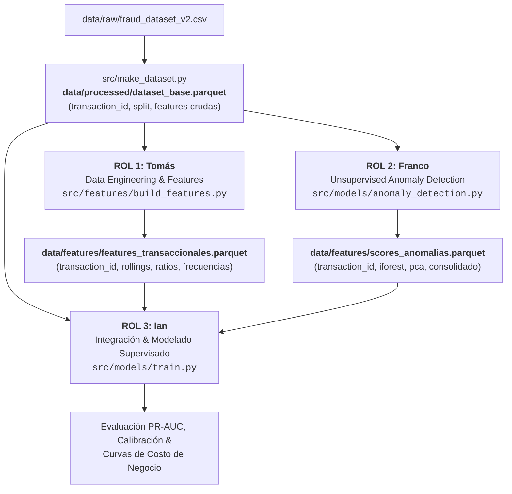

# CONTRATOS.md — Interfaces Técnicas, Roles y Criterios de Aceptación

> **Proyecto:** Detección de Fraude Transaccional (MELI)  
> **Equipo:** Tomás (Data Eng & Features), Franco (Detección de Anomalías), Ian (Modelado & Negocio)  
> **Dataset Base:** `data/processed/dataset_base.parquet`

## Preámbulo: Entorno Python y Ejecución de Scripts

El repositorio incluye [`run.bat`](run.bat) como punto de entrada común para ejecutar los scripts de Python con el entorno del proyecto. Desde PowerShell, en la raíz del repositorio:

```powershell
.\run.bat src/make_dataset.py --help
.\run.bat src/make_dataset.py --input_path data/raw/fraud_dataset_v2.csv
```

El lanzador selecciona la versión de Python declarada en [`.python-version`](.python-version) (actualmente **3.13**), crea el entorno virtual `.venv` si no existe, comprueba las versiones de las dependencias fijadas en [`requirements.txt`](requirements.txt) e instala o corrige las que falten o difieran. Luego ejecuta `pip check` para verificar su compatibilidad y, si la preparación termina correctamente, ejecuta el script solicitado con sus argumentos desde la raíz del repositorio, conservando su código de salida. No es necesario activar `.venv` manualmente.

**Requisitos previos:** tener instalada la versión indicada de Python y el launcher de Windows `py`. La instalación de dependencias requiere acceso a internet. Si falta el intérprete o el entorno existente utiliza otra versión, la ejecución se detiene; el lanzador no instala Python ni reemplaza automáticamente un entorno incompatible.

**Reutilización del entorno:** si `.venv` ya existe, `run.bat` utiliza directamente su intérprete y comprueba su versión, sin recrear ni activar nuevamente el entorno. Si las dependencias instaladas coinciden con `requirements.txt`, no ejecuta `pip install` ni descarga paquetes; únicamente realiza las comprobaciones locales de versiones y `pip check`. El lanzador no permanece encendido ni se activa automáticamente al ejecutar un script por otro medio.

Para aplicar estas comprobaciones, todos los integrantes deben ejecutar los scripts mediante `run.bat`. Ejecutar directamente `python script.py` saltea el control del lanzador. En el IDE, seleccionar `.venv/Scripts/python.exe` como intérprete del proyecto.

---

## 1. Convenciones Globales del Repositorio

* **Identificador Universal Inmutable (`transaction_id`):**  
  Toda fila se identifica de manera unívoca mediante `transaction_id` (string formateado como `tx_000000` a `tx_249999`).  
  > [!IMPORTANT]
  > Ningún integrante puede alterar, reordenar físicamente el índice original, ni eliminar registros sin pasar por la capa de exclusión unificada. `transaction_id` es la única clave primaria para cruces (`merge`) entre tablas.

* **Partición Temporal Estricta (`split`):**  
  La columna `split` (`train`, `val`, `test`) generada en `data/processed/dataset_base.parquet` es la **única fuente de verdad** para entrenamiento, validación y prueba Out-Of-Time (OOT). Queda terminantemente prohibido el remuestreo aleatorio (`train_test_split` global) o K-Fold estratificado aleatorio que viole la causalidad temporal.

* **Formato de Intercambio Tabular:**  
  Todos los artefactos de datos compartidos se exportan y leen en formato `.parquet` con compresión `snappy`, preservando tipos nativos (`int`, `float`, `datetime`, `category`).

* **Principio de Fuente Única de Verdad (Single Source of Truth) e Interoperabilidad R/Python:**  
  Python es el **único entorno autorizado para procesar, transformar y persistir artefactos tabulares compartidos (`.parquet`)** en el repositorio. Queda terminantemente prohibido generar artefactos para modelado desde entornos paralelos en R.  
  * **Pipeline y Escritura:** Todos los filtros de población, particiones temporales (`split`) e ingeniería de variables se computan y persisten exclusivamente mediante scripts de Python (`src/make_dataset.py`, `src/features/build_features.py`) exportando a formato `.parquet` en `data/`.
  * **Consumo y Auditoría:** El uso de R o Quarto (`.Rmd`/`.qmd`) queda restringido a tareas de análisis exploratorio (EDA), auditoría estadística y visualización, consumiendo siempre los archivos `.parquet` procesados vía la librería `arrow` (`arrow::read_parquet()`).
  * **Regla Anti-Duplicación:** Cualquier decisión analítica derivada del EDA en R (transformaciones, descartes o nuevas métricas) debe implementarse formalmente en el script correspondiente de Python antes de ser utilizada por el equipo.

* **Política de Git:**  
  Los archivos binarios (`.parquet`, `.csv`) no se suben a Git (están en `.gitignore`). Cada integrante debe garantizar que su código sea determinista y reproducible desde `data/processed/dataset_base.parquet` ejecutando un comando de CLI reproducible con semilla `random_state=42`.

---

## 2. Arquitectura de Integración de Datos



---

## 3. Contratos de Datos (Interfaces Técnicas Detalladas)

### Contrato A: Integrante 1 $\rightarrow$ Repositorio Común (Tomás)
* **Rol:** Senior Data Engineer / Feature Engineer  
* **Script Generador:** `src/features/build_features.py`  
* **Archivo de Salida:** `data/features/features_transaccionales.parquet`  
* **Frecuencia de Entrega:** Versión preliminar (v1) e iteración final (v2).  
* **Responsabilidad de Implementación Anti-Duplicación:**  
  Toda hipótesis, descarte de registros o transformación validada durante el EDA en R debe implementarse formalmente en el pipeline de Python (`src/features/build_features.py`) antes de exportarse a `data/features/features_transaccionales.parquet`. R no genera datasets intermedios para el resto del equipo.  

#### Esquema Obligatorio:
| Columna | Tipo | Descripción | Restricción Anti-Leakage |
| :--- | :--- | :--- | :--- |
| `transaction_id` | `string` | ID universal (`tx_XXXXXX`) | Debe coincidir 1:1 con `dataset_base.parquet` |
| `monto_ratio_hist_usuario` | `float64` | Ratio entre monto actual y promedio histórico | Solo transacciones anteriores a `fecha` |
| `tx_count_ultimas_24h` | `int64` / `float64` | Frecuencia de transacciones en ventana rodante 24h | Aplicar `shift(1)` estricto |
| `monto_std_7d` | `float64` | Desvío estándar de monto en ventana 7 días | `shift(1)` para excluir la tx actual |
| *(Otras features agregadas)* | `float64` / `int` | Ratios, diferencias y target encodings temporales | Solo estimadas sobre `train` |

> [!WARNING]
> **Restricción Estricta de Causalidad:** Toda feature que use agregaciones de tiempo (`rolling`, `expanding`, ventanas deslizantes) debe usar un desplazamiento temporal o `shift(1)` para no incluir información del evento que se está evaluando. Si se usan target encodings, los priors se calculan **únicamente** con datos de `split == 'train'`.

---

### Contrato B: Integrante 2 $\rightarrow$ Repositorio Común (Franco)
* **Rol:** Machine Learning Engineer — Detección de Anomalías No Supervisadas  
* **Script Generador:** `src/models/anomaly_detection.py`  
* **Archivo de Salida:** `data/features/scores_anomalias.parquet`  
* **Modelos Asignados:** Isolation Forest, PCA (Error de Reconstrucción) y Métodos Locales (LOF / Distancia Mahalanobis o k-NN).  

#### Esquema Obligatorio:
| Columna | Tipo | Rango / Unidad | Descripción |
| :--- | :--- | :--- | :--- |
| `transaction_id` | `string` | `tx_XXXXXX` | Clave primaria para merge |
| `score_iforest` | `float64` | $[0.0, 1.0]$ | Score normalizado o percentil de anomalía (mayor = más anómalo) |
| `error_pca` | `float64` | $[0.0, 1.0]$ | Error de reconstrucción normalizado (MinMax sobre train) |
| `distancia_lof_knn` | `float64` | $[0.0, 1.0]$ | Densidad o distancia local normalizada |
| `score_anomalia_consolidado` | `float64` | $[0.0, 1.0]$ | Ensamble / combinación ponderada no supervisada |

> [!CAUTION]
> **Restricción Metodológica Fundamental:**  
> Los modelos de detección de anomalías son no supervisados pero de naturaleza **one-class**: deben entrenarse (`fit`) **exclusivamente** con las transacciones legítimas (`fraude == 0`) pertenecientes al conjunto `split == 'train'`.  
> Queda prohibido:
> 1. Hacer `fit` incluyendo transacciones etiquetadas como fraude (`fraude == 1`).
> 2. Calcular escaladores o fitear modelos sobre `val` o `test` (solo se permite `transform` / `score_samples`).

---

### Contrato C: Integrante 3 $\rightarrow$ Entrega Final (Ian)
* **Rol:** Lead Data Scientist — Modelado Supervisado, Calibración & Negocio  
* **Script de Integración & Entrenamiento:** `src/models/train.py`  
* **Modelos Asignados:**
  * **Baseline:** Regresión Logística y/o Random Forest (solo con features crudas).
  * **Modelo Retador (Challenger):** LightGBM / XGBoost / CatBoost integrando features transaccionales + scores de anomalías.
  * **Optimización de hiperparámetros:** búsqueda bayesiana con Optuna usando **TPE + pruning** como método principal. Probar además **CMA-ES** como método alternativo y comparar resultados bajo el mismo presupuesto de trials.
  * **Calibración:** Isotonic Regression o Platt Scaling sobre `val`.
  * **Optimización de Negocio:** Función de pérdida / costo financiero y cálculo de umbral óptimo $\tau^*$.

#### Contrato de Optimización de Hiperparámetros
* La búsqueda se ejecuta sobre los modelos supervisados asignados (en particular, los modelos Challenger) y maximiza **PR-AUC en `val`**, dada la naturaleza desbalanceada del problema.
* Cada trial entrena con `split == 'train'` y evalúa con `split == 'val'`, respetando el orden temporal. El conjunto `test` queda reservado para la evaluación final y no puede intervenir en la búsqueda, el pruning, la selección del sampler ni la elección de hiperparámetros.
* El método principal será **TPE + pruning**: sampler TPE con semilla reproducible y un pruner de Optuna (por ejemplo, `MedianPruner`). Los modelos con soporte de entrenamiento incremental deben reportar la métrica intermedia de validación en cada iteración/época para permitir detener trials poco prometedores. Si un modelo no permite pruning por iteración, se documentará y se completará el trial sin pruning; no se simulará pruning.
* **CMA-ES** se probará como sampler alternativo de Optuna en los espacios de búsqueda compatibles. Para que la comparación sea justa, se mantendrán iguales el modelo, los datos, la métrica objetivo, los rangos de búsqueda y el presupuesto de trials; se registrará cualquier parámetro categórico que CMA-ES no pueda optimizar directamente y la estrategia usada para tratarlo.
* La búsqueda debe respetar el anti-leakage: preprocesadores se ajustan solo con `train`; `val` solo se usa para calcular la métrica objetivo e informar al pruner. Los datos `test` no se consultan hasta congelar la configuración elegida.
* Se deben guardar el sampler, la semilla, el pruner, el número de trials, el espacio de búsqueda, los parámetros y métricas de cada trial, los trials podados y la mejor configuración. Los resultados deben quedar documentados y ser reproducibles desde CLI con `--seed` (por defecto `42`).

**Criterio de comparación:** reportar la mejor PR-AUC de validación y el costo/tiempo de búsqueda para TPE + pruning y CMA-ES. Seleccionar la configuración final únicamente con `val`; luego reentrenar según el procedimiento definido y evaluar una sola vez en `test`.

#### Código de Integración Estándar (`src/models/train.py`):
```python
import pandas as pd

def build_full_dataset(
    base_path="data/processed/dataset_base.parquet",
    feat_path="data/features/features_transaccionales.parquet",
    anom_path="data/features/scores_anomalias.parquet",
) -> pd.DataFrame:
    df_base = pd.read_parquet(base_path)
    df_feat = pd.read_parquet(feat_path)
    df_anom = pd.read_parquet(anom_path)

    # Merge determinista 1:1 por transaction_id
    df_full = (
        df_base
        .merge(df_feat, on="transaction_id", how="left")
        .merge(df_anom, on="transaction_id", how="left")
    )

    # Aserción de integridad
    assert len(df_full) == len(df_base), "Error: El merge alteró la cantidad de filas."
    assert df_full["transaction_id"].nunique() == len(df_base), "Error: Hay transaction_id duplicados."
    return df_full
```

#### Entregables de Negocio:
1. **Curva PR-AUC & ROC-AUC:** Reporte comparativo en `val` y `test`:
   * Modelo Baseline vs.
   * Modelo con Features Transaccionales vs.
   * Modelo Completo (+ Scores de Anomalías).
2. **Matriz de Costos y Función Económica:**
   $$\text{Costo Total}(\tau) = C_{FN} \times FN(\tau) + C_{FP} \times FP(\tau)$$
   donde $C_{FN}$ representa el monto defraudado no recuperado y $C_{FP}$ el costo operativo / fricción del cliente por falso positivo.
3. **Determinación del Umbral Óptimo $\tau^*$:** Selección del punto de operación maximizando el ahorro neto o minimizando el costo esperado en `test`.

---

## 4. Criterios de Aceptación (Definition of Done — DoD)

| # | Criterio | Validación Obligatoria |
| :-: | :--- | :--- |
| **1** | **Anti-Leakage Estricto** | Todo escalador (`StandardScaler`, etc.), imputador o estimador debe ser fiteado **únicamente** en `train`. En `val` y `test` solo se ejecuta `.transform()`. |
| **2** | **Merge Determinista & Sin NaNs** | El dataset integrado debe conservar exactamente las $150.000$ filas de `dataset_base.parquet` (tras la exclusión justificada del Bloque 2 validada en EDA). No se admiten registros huérfanos ni multiplicados. |
| **3** | **Reproducibilidad Total** | Todos los scripts ejecutables deben aceptar `--seed` con valor por defecto `42`. |
| **4** | **Compatibilidad de Esquemas** | Todo Parquet exportado en `data/features/` debe incluir `transaction_id` como primera columna de tipo `string`. |
| **5** | **Documentación de Experimentos** | Métricas reportadas en `test` deben haber sido congeladas sin reajustes de hiperparámetros post-evaluación. |
