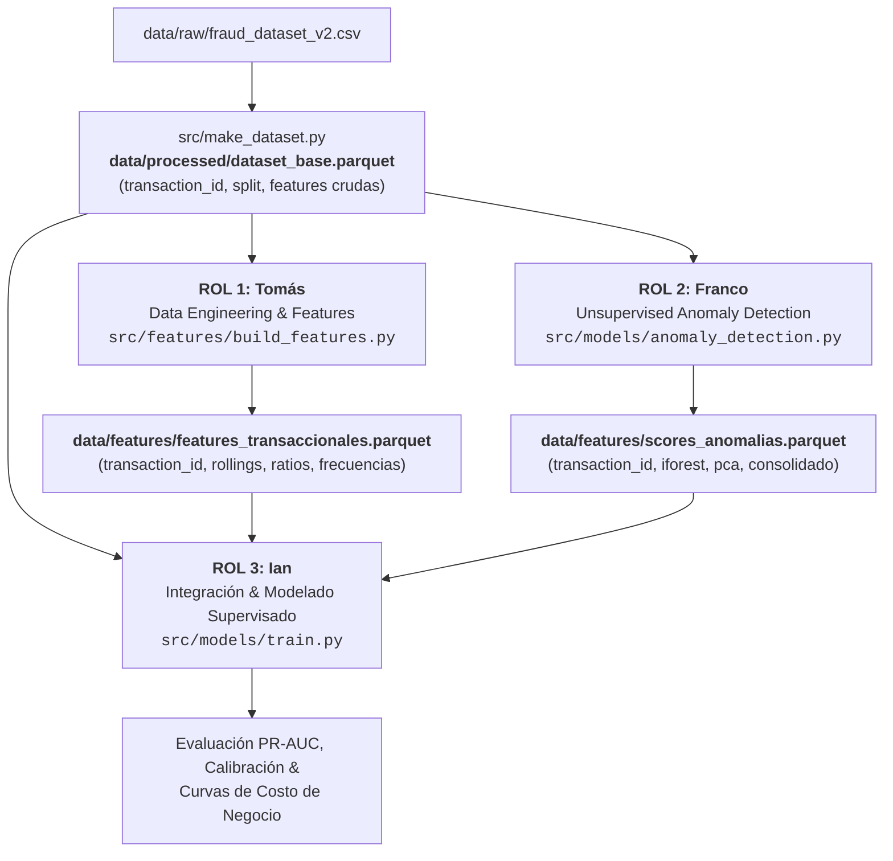

# CONTRATOS.md — Interfaces Técnicas, Roles y Criterios de Aceptación

> **Proyecto:** Detección de Fraude Transaccional (MELI)  
> **Equipo:** Tomás (Data Eng & Features), Franco (Detección de Anomalías), Ian (Modelado & Negocio)  
> **Dataset Base:** `data/processed/dataset_base.parquet`

---

## 1. Convenciones Globales del Repositorio

* **Identificador Universal Inmutable (`transaction_id`):**  
  Toda fila se identifica de manera unívoca mediante `transaction_id` (string formateado como `tx_000000` a `tx_249999`).  
  > [!IMPORTANT]
  > Ningún integrante puede alterar, reordenar físicamente el índice original, ni eliminar registros sin pasar por la capa de exclusión unificada. `transaction_id` es la única clave primaria para cruces (`merge`) entre tablas.

* **Partición Temporal Estricta (`split`):**  
  La columna `split` (`train`, `val`, `test`) generada en `data/processed/dataset_base.parquet` es la **única fuente de verdad** para entrenamiento, validación y prueba Out-Of-Time (OOT). Queda terminantemente prohibido el remuestreo aleatorio (`train_test_split` global) o K-Fold estratificado aleatorio que viole la causalidad temporal.

* **Formato de Intercambio Tabular:**  
  Todos los artefactos de datos compartidos se exportan y leen en formato `.parquet` con compresión `snappy`, preservando tipos nativos (`int`, `float`, `datetime`, `category`).

* **Principio de Fuente Única de Verdad (Single Source of Truth) e Interoperabilidad R/Python:**  
  Python es el **único entorno autorizado para procesar, transformar y persistir artefactos tabulares compartidos (`.parquet`)** en el repositorio. Queda terminantemente prohibido generar artefactos para modelado desde entornos paralelos en R.  
  * **Pipeline y Escritura:** Todos los filtros de población, particiones temporales (`split`) e ingeniería de variables se computan y persisten exclusivamente mediante scripts de Python (`src/make_dataset.py`, `src/features/build_features.py`) exportando a formato `.parquet` en `data/`.
  * **Consumo y Auditoría:** El uso de R o Quarto (`.Rmd`/`.qmd`) queda restringido a tareas de análisis exploratorio (EDA), auditoría estadística y visualización, consumiendo siempre los archivos `.parquet` procesados vía la librería `arrow` (`arrow::read_parquet()`).
  * **Regla Anti-Duplicación:** Cualquier decisión analítica derivada del EDA en R (transformaciones, descartes o nuevas métricas) debe implementarse formalmente en el script correspondiente de Python antes de ser utilizada por el equipo.

* **Política de Git:**  
  Los archivos binarios (`.parquet`, `.csv`) no se suben a Git (están en `.gitignore`). Cada integrante debe garantizar que su código sea determinista y reproducible desde `data/processed/dataset_base.parquet` ejecutando un comando de CLI reproducible con semilla `random_state=42`.

---

## 2. Arquitectura de Integración de Datos



---

## 3. Contratos de Datos (Interfaces Técnicas Detalladas)

### Contrato A: Integrante 1 $\rightarrow$ Repositorio Común (Tomás)
* **Rol:** Senior Data Engineer / Feature Engineer  
* **Script Generador:** `src/features/build_features.py`  
* **Archivo de Salida:** `data/features/features_transaccionales.parquet`  
* **Frecuencia de Entrega:** Versión preliminar (v1) e iteración final (v2).  
* **Responsabilidad de Implementación Anti-Duplicación:**  
  Toda hipótesis, descarte de registros o transformación validada durante el EDA en R debe implementarse formalmente en el pipeline de Python (`src/features/build_features.py`) antes de exportarse a `data/features/features_transaccionales.parquet`. R no genera datasets intermedios para el resto del equipo.  

#### Esquema Oficial Producción (v2):

> [!NOTE]
> **Diccionario Exhaustivo de Características:**  
> La explicación profunda, justificación de negocio, formulación matemática completa, análisis de asimetrías y métricas de gain empírico para cada una de las 50 variables ingenierizadas, variables crudas y scores de anomalías se encuentran documentadas en **[docs/DICCIONARIO_VARIABLES.md](docs/DICCIONARIO_VARIABLES.md)**.

| Columna | Tipo | Descripción | Restricción Anti-Leakage / Validación Proxy |
| :--- | :--- | :--- | :--- |
| `transaction_id` | `string` | ID universal (`tx_XXXXXX`) | Clave primaria determinista (150.000 filas) |
| `ratio_monto_ag_bayes` | `float64` | Ratio normalizado de monto por `(a, g)` con suavizado bayesiano | Priors y medias ajustados **estrictamente** sobre `train` |
| `ratio_monto_b` | `float64` | Tensión ticket monetario / tasa continua `b` (`monto / (b + 0.001)`) | Sin leakage. Gain: ~1.884 |
| `prod_b_log_c` | `float64` | Interacción no lineal `b * log1p(c)` | Sin leakage. Gain: ~1.318 |
| `ratio_monto_c` | `float64` | Escala relativa `monto / (c + 1.0)` | Sin leakage. Gain: ~2.300 |
| `ratio_d_m` | `float64` | Proporción relativa `d / (m + 1.0)` | Sin leakage. Gain: ~2.506 |
| `ratio_monto_m` | `float64` | Normalización del ticket respecto a `m` (`monto / (m + 1.0)`) | Sin leakage. Gain: ~3.141 |
| `diff_m_d` | `float64` | Discrepancia directa `m - d` | Sin leakage. Gain: ~4.464 |
| `ratio_monto_f` | `float64` | Ticket normalizado `monto / (max(f, 0) + 1.0)` | Domina outlier 145k. Gain: ~4.540 |
| `ratio_monto_e` | `float64` | Ticket normalizado `monto / (e + 0.01)` | Sin leakage. Gain: ~795 |
| `log_f` | `float64` | Compresión logarítmica `log1p(max(f, 0))` | Mitiga asimetría pesada. Gain: ~300 |
| `is_f_cero_neg` | `int8` | Flag booleano `f <= 0` (segmento crítico 12% fraude) | Sin leakage |
| `is_e_cero` | `int8` | Flag booleano `e == 0` (masa puntual 44%) | Sin leakage |
| `ratio_monto_h` | `float64` | Ticket normalizado `monto / (h + 1.0)` | Tensión ticket / madurez. Gain: ~1.375 |
| `is_h_cero` | `int8` | Flag booleano `h == 0` (segmento crítico 9.6% fraude) | Sin leakage |
| `log_h` | `float64` | Compresión logarítmica `log1p(h)` | Sin leakage |
| `char_len` | `float64` | Longitud en caracteres del título `i` | Sin leakage |
| `word_count` | `float64` | Cantidad de palabras en el título `i` | Sin leakage |
| `avg_word_len` | `float64` | Longitud promedio de palabra (`char_len / word_count`) | Sin leakage |
| `digit_ratio` | `float64` | Proporción de números/dígitos en el título | Sin leakage |
| `text_svd_1` a `text_svd_10` | `float64` | 10 componentes continuos de LSA (TF-IDF + TruncatedSVD optimizado por regla del codo) | Ajustados estrictamente sobre `train` |
| `score_texto_nb` | `float64` | Probabilidad bayesiana OOF temporal (Naive Bayes, $\alpha=2.0, min\_df=30$) | `TimeSeriesSplit` estricto en `train`. Gain: ~3.400 |
| `te_j_bayes` | `float64` | Target Encoding bayesiano sobre categoría `j` ($m=10$, KFold 5 OOF con jitter gaussiano $\sigma=0.01$) | Regularizado contra memorización. Gain: ~7.115 |
| `freq_j` | `float64` | Log-frecuencia observada de la categoría `j` en train (`log1p(count)`) | Priors de train, fallback 0. Gain: ~926 |
| `ratio_monto_j_bayes` | `float64` | Ticket normalizado respecto a la mediana bayesiana de la categoría `j` ($m=20$) | Sin leakage. Gain: ~643 |
| `hora_cont` | `float64` | Tiempo continuo fraccional del día ($hora + min/60 + seg/3600$) | Sin leakage. Gain: ~2.227 |
| `cos_hora` | `float64` | Proyección cíclica $\cos(2\pi \cdot hora\_cont / 24)$ (detector noche vs día continuo) | Sin leakage. Gain: ~1.305 |
| `sin_hora` | `float64` | Proyección cíclica $\sin(2\pi \cdot hora\_cont / 24)$ (gradiente continuo mañana vs tarde) | Sin leakage. Gain: ~610 |
| `log_l` | `float64` | Compresión logarítmica $\log(1 + \max(l, 0))$ | Sin leakage |
| `log_m` | `float64` | Compresión logarítmica $\log(1 + \max(m, 0))$ | Sin leakage |
| `ratio_monto_l` | `float64` | Tensión ticket monetario sobre antigüedad $l$ ($monto / (l + 1)$) | Sin leakage |
| `score_x_monto` | `float64` | Métrica de exposición de riesgo ($score \times monto$) | Sin leakage |
| `ratio_monto_q` | `float64` | Ticket normalizado por tasa $q$ ($monto / (q + 0.01)$) | Sin leakage |
| `flag_alto_riesgo_nop` | `int8` | Flag booleano de coincidencia de segmentos de alto riesgo ($n=0, o=\text{'N'}, p=\text{'N'}$) | Sin leakage |
| `is_o_missing` | `int8` | Flag indicador de ausencia en variable $o$ (72% missing) | Sin leakage |
| `es_madrugada` | `int8` | Flag binario de ventana nocturna optimizada ($hora \ge 23 \lor hora \le 5$ UTC) | Sin leakage. Gain: ~1.899 |
| `dia_semana` | `float64` | Día de la semana numérico ($0.0 \dots 6.0$) | Sin leakage |
| `log_monto` | `float64` | Compresión logarítmica $\log(1 + \max(monto, 0))$ (mitiga asimetría de 9.57) | Sin leakage. Gain: ~1.102 |
| `monto_centavos` | `float64` | Parte decimal / centavos ($0 \dots 99$, captura patrones de precios psicológicos) | Sin leakage. Gain: ~659 |
| `is_monto_alto` | `int8` | Flag booleano de ticket extremo pertenecientes al percentil 99 superior ($monto > 422$) | Sin leakage. Gain: ~93 |
| `log_delta_mismo_prod` | `float64` | Tiempo en escala logarítmica $\log(1 + \Delta t)$ desde última venta del mismo producto $i$ | Causal con shift(1). Imputación 30d |
| `burst_mismo_prod_24h` | `int8` | Flag binario de ráfaga del mismo producto en ventana $\le 24$ horas | Causal con shift(1) |

> [!NOTE]
> **Selección Final de Variables (Entregable Oficial Curado para Modelado):**  
> Mediante el módulo `src/features/run_forward_selection_global.py`, se consolidó el dataset optimizado oficial para el modelado supervisado en Contrato C:
> * **Forward Stepwise Global Blindado (`data/features/features_seleccionadas_end_to_end.parquet` - OFICIAL):**  
>   Competencia abierta libre entre las 67 variables (17 base + 50 ingenierizadas) con parada temprana por paciencia (`min_delta = 0.0003`, `patience = 2`).  
>   Retiene **4 base** (`score, o, g, a`) y **7 ingenierizadas** (`es_madrugada, ratio_d_m, ratio_monto_l, prod_b_log_c, score_texto_nb, ratio_monto_e, is_h_cero`).  
>   **PR-AUC: `0.4622` (+0.0335 vs baseline de 17 crudas)** con solo 11 variables blindadas ante leakage temporal. Reporte auditable: `selected_features_end_to_end_report.json`.

> [!WARNING]
> **Restricción Estricta de Causalidad:** Toda feature que use agregaciones de tiempo (`rolling`, `expanding`, ventanas deslizantes) debe usar un desplazamiento temporal o `shift(1)` para no incluir información del evento que se está evaluando. Si se usan target encodings, los priors se calculan **únicamente** con datos de `split == 'train'`.

---

### Contrato B: Integrante 2 $\rightarrow$ Repositorio Común (Franco)
* **Rol:** Machine Learning Engineer — Detección de Anomalías No Supervisadas  
* **Script Generador:** `src/models/anomaly_detection.py`  
* **Archivo de Salida:** `data/features/scores_anomalias.parquet`  
* **Modelos Asignados:** Isolation Forest, PCA (Error de Reconstrucción) y Métodos Locales (LOF / Distancia Mahalanobis o k-NN).  

#### Esquema Obligatorio:
| Columna | Tipo | Rango / Unidad | Descripción |
| :--- | :--- | :--- | :--- |
| `transaction_id` | `string` | `tx_XXXXXX` | Clave primaria para merge |
| `score_iforest` | `float64` | $[0.0, 1.0]$ | Score normalizado o percentil de anomalía (mayor = más anómalo) |
| `error_pca` | `float64` | $[0.0, 1.0]$ | Error de reconstrucción normalizado (MinMax sobre train) |
| `distancia_lof_knn` | `float64` | $[0.0, 1.0]$ | Densidad o distancia local normalizada |
| `score_anomalia_consolidado` | `float64` | $[0.0, 1.0]$ | Ensamble / combinación ponderada no supervisada |

> [!CAUTION]
> **Restricción Metodológica Fundamental:**  
> Los modelos de detección de anomalías son no supervisados pero de naturaleza **one-class**: deben entrenarse (`fit`) **exclusivamente** con las transacciones legítimas (`fraude == 0`) pertenecientes al conjunto `split == 'train'`.  
> Queda prohibido:
> 1. Hacer `fit` incluyendo transacciones etiquetadas como fraude (`fraude == 1`).
> 2. Calcular escaladores o fitear modelos sobre `val` o `test` (solo se permite `transform` / `score_samples`).

---

### Módulo Satélite Opcional: Reglas de Asociación Heurísticas CARs (Franco / Tomás)
* **Script Generador:** `src/features/build_rule_features.py`  
* **Archivo de Salida:** `data/features/features_reglas_asociacion.parquet`  
* **Propósito:** Módulo desacoplado de 10 reglas de asociación (CARs) para interpretabilidad y auditoría sin alterar el pipeline transaccional central.  
* **Integración en Modelado:** Opcional vía `df.merge(features_reglas, on='transaction_id')`. Documentado en detalle en `docs/DICCIONARIO_VARIABLES.md`.

---

### Contrato C: Integrante 3 $\rightarrow$ Entrega Final (Ian)
* **Rol:** Lead Data Scientist — Modelado Supervisado, Calibración & Negocio  
* **Script de Integración & Entrenamiento:** `src/models/train.py`  
* **Modelos Asignados:**
  * **Baseline:** Regresión Logística y/o Random Forest (solo con features crudas).
  * **Modelo Retador (Challenger):** LightGBM / XGBoost / CatBoost integrando features transaccionales + scores de anomalías.
  * **Optimización de hiperparámetros:** búsqueda bayesiana con Optuna usando **TPE + pruning** como método principal. Probar además **CMA-ES** como método alternativo y comparar resultados bajo el mismo presupuesto de trials.
  * **Calibración:** Isotonic Regression o Platt Scaling sobre `val`.
  * **Optimización de Negocio:** Función de pérdida / costo financiero y cálculo de umbral óptimo $\tau^*$.

#### Contrato de Optimización de Hiperparámetros
* La búsqueda se ejecuta sobre los modelos supervisados asignados (en particular, los modelos Challenger) y maximiza **PR-AUC en `val`**, dada la naturaleza desbalanceada del problema.
* Cada trial entrena con `split == 'train'` y evalúa con `split == 'val'`, respetando el orden temporal. El conjunto `test` queda reservado para la evaluación final y no puede intervenir en la búsqueda, el pruning, la selección del sampler ni la elección de hiperparámetros.
* El método principal será **TPE + pruning**: sampler TPE con semilla reproducible y un pruner de Optuna (por ejemplo, `MedianPruner`). Los modelos con soporte de entrenamiento incremental deben reportar la métrica intermedia de validación en cada iteración/época para permitir detener trials poco prometedores. Si un modelo no permite pruning por iteración, se documentará y se completará el trial sin pruning; no se simulará pruning.
* **CMA-ES** se probará como sampler alternativo de Optuna en los espacios de búsqueda compatibles. Para que la comparación sea justa, se mantendrán iguales el modelo, los datos, la métrica objetivo, los rangos de búsqueda y el presupuesto de trials; se registrará cualquier parámetro categórico que CMA-ES no pueda optimizar directamente y la estrategia usada para tratarlo.
* La búsqueda debe respetar el anti-leakage: preprocesadores se ajustan solo con `train`; `val` solo se usa para calcular la métrica objetivo e informar al pruner. Los datos `test` no se consultan hasta congelar la configuración elegida.
* Se deben guardar el sampler, la semilla, el pruner, el número de trials, el espacio de búsqueda, los parámetros y métricas de cada trial, los trials podados y la mejor configuración. Los resultados deben quedar documentados y ser reproducibles desde CLI con `--seed` (por defecto `42`).

**Criterio de comparación:** reportar la mejor PR-AUC de validación y el costo/tiempo de búsqueda para TPE + pruning y CMA-ES. Seleccionar la configuración final únicamente con `val`; luego reentrenar según el procedimiento definido y evaluar una sola vez en `test`.

#### Opciones de Features Entregadas por Contrato A para Ian:
Contrato A pone a disposición de Ian las siguientes fuentes según la arquitectura de modelado elegida:
1. **Entregable Oficial Blindado End-to-End (RECOMENDADO):** `data/features/features_seleccionadas_end_to_end.parquet`
   - **11 variables estructurales:** 4 base (`score, o, g, a`) + 7 ingenierizadas (`es_madrugada, ratio_d_m, ratio_monto_l, prod_b_log_c, score_texto_nb, ratio_monto_e, is_h_cero`).
   - Métrica en validación: **`PR-AUC = 0.4622`** (+0.0335 vs baseline crudo de 17 variables).
   - Optimización de ventana nocturna (`23:00 - 05:59 UTC`) permitió a `es_madrugada` entrar en Paso 4 (+0.0120 directo) y desbloquear un subconjunto óptimo y parsimonioso sin ruido residual.
2. **Pool Completo Transaccional:** `data/features/features_transaccionales.parquet`
   - Las 50 features ingenierizadas completas para modelos que apliquen regularización intrínseca (L1/L2, `subsample`, `colsample_bytree`) o búsqueda con Optuna.
3. **Módulo Satélite de Reglas CARs:** `data/features/features_reglas_asociacion.parquet`
   - Panel de 10 reglas booleanas y porcentaje de violaciones (`score_heuristico_fraude_10`, `pct_heuristico_fraude`) para análisis de interpretabilidad.

> [!CAUTION]
> **Alerta Metodológica sobre Validación Leakage:**  
> Se realizaron auditorías con `TimeSeriesSplit` interno dentro de `train` para verificar la estabilidad de las features. Se instruye a Ian no sobre-optimizar hiperparámetros con cientos de trials que puedan memorizar la partición OOT de `val`. El conjunto `test` debe permanecer estrictamente sellado hasta la corrida de inferencia final.

#### Código de Integración Estándar (`src/models/train.py`):
```python
import pandas as pd

def build_full_dataset(
    base_path="data/processed/dataset_base.parquet",
    # Entregable oficial: "data/features/features_seleccionadas_end_to_end.parquet" (11 vars)
    feat_path="data/features/features_seleccionadas_end_to_end.parquet",
    anom_path="data/features/scores_anomalias.parquet",
) -> pd.DataFrame:
    df_base = pd.read_parquet(base_path)
    df_feat = pd.read_parquet(feat_path)
    df_anom = pd.read_parquet(anom_path)

    # Merge determinista 1:1 por transaction_id
    # Nota: Si se usa la opción Blindada (end_to_end), esta ya incluye las variables base seleccionadas,
    # por lo que el merge selecciona únicamente las columnas de df_feat más las necesarias de df_base (fraude, split, fecha).
    if "score" in df_feat.columns:
        # Opción End-to-End
        meta_cols = ["transaction_id", "fraude", "split", "fecha"]
        df_full = df_base[meta_cols].merge(df_feat, on="transaction_id", how="left")
    else:
        # Opción Incremental o Pool Completo
        df_full = df_base.merge(df_feat, on="transaction_id", how="left")

    df_full = df_full.merge(df_anom, on="transaction_id", how="left")

    # Aserción de integridad
    assert len(df_full) == len(df_base), "Error: El merge alteró la cantidad de filas."
    assert df_full["transaction_id"].nunique() == len(df_base), "Error: Hay transaction_id duplicados."
    return df_full
```

#### Entregables de Negocio:
1. **Curva PR-AUC & ROC-AUC:** Reporte comparativo en `val` y `test`:
   * Modelo Baseline vs.
   * Modelo con Features Transaccionales vs.
   * Modelo Completo (+ Scores de Anomalías).
2. **Matriz de Costos y Función Económica:**
   $$\text{Costo Total}(\tau) = C_{FN} \times FN(\tau) + C_{FP} \times FP(\tau)$$
   donde $C_{FN}$ representa el monto defraudado no recuperado y $C_{FP}$ el costo operativo / fricción del cliente por falso positivo.
3. **Determinación del Umbral Óptimo $\tau^*$:** Selección del punto de operación maximizando el ahorro neto o minimizando el costo esperado en `test`.

---

## 4. Criterios de Aceptación (Definition of Done — DoD)

| # | Criterio | Validación Obligatoria |
| :-: | :--- | :--- |
| **1** | **Anti-Leakage Estricto** | Todo escalador (`StandardScaler`, etc.), imputador o estimador debe ser fiteado **únicamente** en `train`. En `val` y `test` solo se ejecuta `.transform()`. |
| **2** | **Merge Determinista & Sin NaNs** | El dataset integrado debe conservar exactamente las $150.000$ filas de `dataset_base.parquet` (tras la exclusión justificada del Bloque 2 validada en EDA). No se admiten registros huérfanos ni multiplicados. |
| **3** | **Reproducibilidad Total** | Todos los scripts ejecutables deben aceptar `--seed` con valor por defecto `42`. |
| **4** | **Compatibilidad de Esquemas** | Todo Parquet exportado en `data/features/` debe incluir `transaction_id` como primera columna de tipo `string`. |
| **5** | **Documentación de Experimentos** | Métricas reportadas en `test` deben haber sido congeladas sin reajustes de hiperparámetros post-evaluación. |
