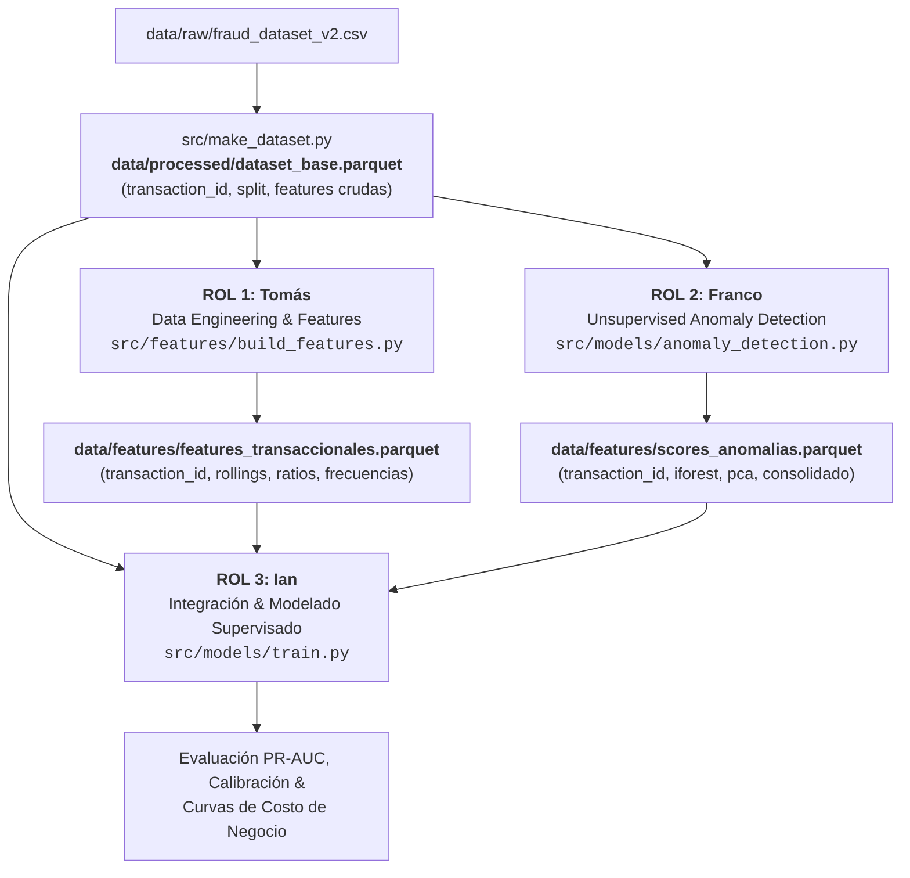

# CONTRATOS.md — Interfaces Técnicas, Roles y Criterios de Aceptación

> **Proyecto:** Detección de Fraude Transaccional (MELI)  
> **Equipo:** Tomás (Data Eng & Features), Franco (Detección de Anomalías), Ian (Modelado & Negocio)  
> **Dataset Base:** `data/processed/dataset_base.parquet`

---

## 1. Convenciones Globales del Repositorio

* **Identificador Universal Inmutable (`transaction_id`):**  
  Toda fila se identifica de manera unívoca mediante `transaction_id` (string formateado como `tx_000000` a `tx_249999`).  
  > [!IMPORTANT]
  > Ningún integrante puede alterar, reordenar físicamente el índice original, ni eliminar registros sin pasar por la capa de exclusión unificada. `transaction_id` es la única clave primaria para cruces (`merge`) entre tablas.

* **Partición Temporal Estricta (`split`):**  
  La columna `split` (`train`, `val`, `test`) generada en `data/processed/dataset_base.parquet` es la **única fuente de verdad** para entrenamiento, validación y prueba Out-Of-Time (OOT). Queda terminantemente prohibido el remuestreo aleatorio (`train_test_split` global) o K-Fold estratificado aleatorio que viole la causalidad temporal.

* **Formato de Intercambio Tabular:**  
  Todos los artefactos de datos compartidos se exportan y leen en formato `.parquet` con compresión `snappy`, preservando tipos nativos (`int`, `float`, `datetime`, `category`).

* **Política de Git:**  
  Los archivos binarios (`.parquet`, `.csv`) no se suben a Git (están en `.gitignore`). Cada integrante debe garantizar que su código sea determinista y reproducible desde `data/processed/dataset_base.parquet` ejecutando un comando de CLI reproducible con semilla `random_state=42`.

---

## 2. Arquitectura de Integración de Datos



---

## 3. Contratos de Datos (Interfaces Técnicas Detalladas)

### Contrato A: Integrante 1 $\rightarrow$ Repositorio Común (Tomás)
* **Rol:** Senior Data Engineer / Feature Engineer  
* **Script Generador:** `src/features/build_features.py`  
* **Archivo de Salida:** `data/features/features_transaccionales.parquet`  
* **Frecuencia de Entrega:** Versión preliminar (v1) e iteración final (v2).  

#### Esquema Obligatorio:
| Columna | Tipo | Descripción | Restricción Anti-Leakage |
| :--- | :--- | :--- | :--- |
| `transaction_id` | `string` | ID universal (`tx_XXXXXX`) | Debe coincidir 1:1 con `dataset_base.parquet` |
| `monto_ratio_hist_usuario` | `float64` | Ratio entre monto actual y promedio histórico | Solo transacciones anteriores a `fecha` |
| `tx_count_ultimas_24h` | `int64` / `float64` | Frecuencia de transacciones en ventana rodante 24h | Aplicar `shift(1)` estricto |
| `monto_std_7d` | `float64` | Desvío estándar de monto en ventana 7 días | `shift(1)` para excluir la tx actual |
| *(Otras features agregadas)* | `float64` / `int` | Ratios, diferencias y target encodings temporales | Solo estimadas sobre `train` |

> [!WARNING]
> **Restricción Estricta de Causalidad:** Toda feature que use agregaciones de tiempo (`rolling`, `expanding`, ventanas deslizantes) debe usar un desplazamiento temporal o `shift(1)` para no incluir información del evento que se está evaluando. Si se usan target encodings, los priors se calculan **únicamente** con datos de `split == 'train'`.

---

### Contrato B: Integrante 2 $\rightarrow$ Repositorio Común (Franco)
* **Rol:** Machine Learning Engineer — Detección de Anomalías No Supervisadas  
* **Script Generador:** `src/models/anomaly_detection.py`  
* **Archivo de Salida:** `data/features/scores_anomalias.parquet`  
* **Modelos Asignados:** Isolation Forest, PCA (Error de Reconstrucción) y Métodos Locales (LOF / Distancia Mahalanobis o k-NN).  

#### Esquema Obligatorio:
| Columna | Tipo | Rango / Unidad | Descripción |
| :--- | :--- | :--- | :--- |
| `transaction_id` | `string` | `tx_XXXXXX` | Clave primaria para merge |
| `score_iforest` | `float64` | $[0.0, 1.0]$ | Score normalizado o percentil de anomalía (mayor = más anómalo) |
| `error_pca` | `float64` | $[0.0, 1.0]$ | Error de reconstrucción normalizado (MinMax sobre train) |
| `distancia_lof_knn` | `float64` | $[0.0, 1.0]$ | Densidad o distancia local normalizada |
| `score_anomalia_consolidado` | `float64` | $[0.0, 1.0]$ | Ensamble / combinación ponderada no supervisada |

> [!CAUTION]
> **Restricción Metodológica Fundamental:**  
> Los modelos de detección de anomalías son no supervisados pero de naturaleza **one-class**: deben entrenarse (`fit`) **exclusivamente** con las transacciones legítimas (`fraude == 0`) pertenecientes al conjunto `split == 'train'`.  
> Queda prohibido:
> 1. Hacer `fit` incluyendo transacciones etiquetadas como fraude (`fraude == 1`).
> 2. Calcular escaladores o fitear modelos sobre `val` o `test` (solo se permite `transform` / `score_samples`).

---

### Contrato C: Integrante 3 $\rightarrow$ Entrega Final (Ian)
* **Rol:** Lead Data Scientist — Modelado Supervisado, Calibración & Negocio  
* **Script de Integración & Entrenamiento:** `src/models/train.py`  
* **Modelos Asignados:**
  * **Baseline:** Regresión Logística y/o Random Forest (solo con features crudas).
  * **Modelo Retador (Challenger):** LightGBM / XGBoost / CatBoost integrando features transaccionales + scores de anomalías.
  * **Calibración:** Isotonic Regression o Platt Scaling sobre `val`.
  * **Optimización de Negocio:** Función de pérdida / costo financiero y cálculo de umbral óptimo $\tau^*$.

#### Código de Integración Estándar (`src/models/train.py`):
```python
import pandas as pd

def build_full_dataset(
    base_path="data/processed/dataset_base.parquet",
    feat_path="data/features/features_transaccionales.parquet",
    anom_path="data/features/scores_anomalias.parquet",
) -> pd.DataFrame:
    df_base = pd.read_parquet(base_path)
    df_feat = pd.read_parquet(feat_path)
    df_anom = pd.read_parquet(anom_path)

    # Merge determinista 1:1 por transaction_id
    df_full = (
        df_base
        .merge(df_feat, on="transaction_id", how="left")
        .merge(df_anom, on="transaction_id", how="left")
    )

    # Aserción de integridad
    assert len(df_full) == len(df_base), "Error: El merge alteró la cantidad de filas."
    assert df_full["transaction_id"].nunique() == len(df_base), "Error: Hay transaction_id duplicados."
    return df_full
```

#### Entregables de Negocio:
1. **Curva PR-AUC & ROC-AUC:** Reporte comparativo en `val` y `test`:
   * Modelo Baseline vs.
   * Modelo con Features Transaccionales vs.
   * Modelo Completo (+ Scores de Anomalías).
2. **Matriz de Costos y Función Económica:**
   $$\text{Costo Total}(\tau) = C_{FN} \times FN(\tau) + C_{FP} \times FP(\tau)$$
   donde $C_{FN}$ representa el monto defraudado no recuperado y $C_{FP}$ el costo operativo / fricción del cliente por falso positivo.
3. **Determinación del Umbral Óptimo $\tau^*$:** Selección del punto de operación maximizando el ahorro neto o minimizando el costo esperado en `test`.

---

## 4. Criterios de Aceptación (Definition of Done — DoD)

| # | Criterio | Validación Obligatoria |
| :-: | :--- | :--- |
| **1** | **Anti-Leakage Estricto** | Todo escalador (`StandardScaler`, etc.), imputador o estimador debe ser fiteado **únicamente** en `train`. En `val` y `test` solo se ejecuta `.transform()`. |
| **2** | **Merge Determinista & Sin NaNs** | El dataset integrado debe conservar exactamente las $N$ filas de `dataset_base.parquet` ($250.000$ o $150.000$ según exclusión del Bloque 2). No se admiten registros huérfanos ni multiplicados. |
| **3** | **Reproducibilidad Total** | Todos los scripts ejecutables deben aceptar `--seed` con valor por defecto `42`. |
| **4** | **Compatibilidad de Esquemas** | Todo Parquet exportado en `data/features/` debe incluir `transaction_id` como primera columna de tipo `string`. |
| **5** | **Documentación de Experimentos** | Métricas reportadas en `test` deben haber sido congeladas sin reajustes de hiperparámetros post-evaluación. |
