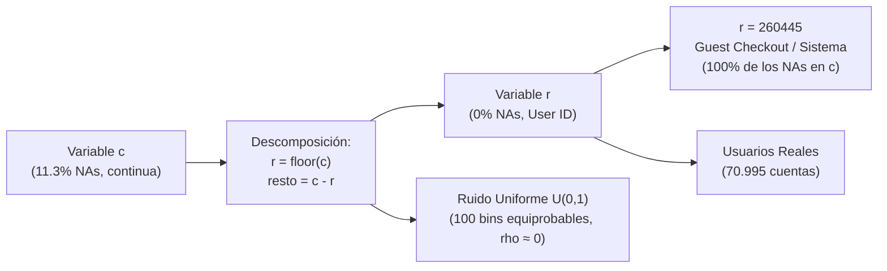

# Compendio de Hallazgos, Hipótesis y Feature Engineering (Legacy EDA)

> **Autor del análisis original:** Tomás  
> **Fuentes analizadas:** `legacy/eda_meli.Rmd`, `legacy/regresion_logistica.Rmd`, `legacy/Modelado_baseline_nb.Rmd`  
> **Objetivo:** Documentar y trasladar los hallazgos al pipeline modular de Python (`src/features/build_features.py` y `src/models/train.py`).

---

## 1. Ingeniería Inversa y Desanonimización de Variables

### A. Desmitificación de `c` vs `r`
* **Estructura matemática:** $r = \lfloor c \rfloor$ en el $100\%$ de los registros completos. `r` representa el identificador real de la cuenta o usuario.
* **Ruido sintético ($c - r$):** Sigue una distribución uniforme discreta en $\{0.00, 0.01, \dots, 0.99\}$. Su correlación con el fraude y el resto de covariables es nula ($|\rho| < 0.0085$).
* **Jittering por fila:** En un mismo usuario recurrente, la parte decimal varía aleatoriamente entre transacciones consecutivas.
* **Decisión de modelado:** Descartar `c`. Conservar y trabajar exclusivamente con `r`.

### B. Descubrimiento de la Entidad Comodín (`r = 260445`)
* El **$100\%$ de los valores faltantes en `c`** corresponden de forma unívoca a `r = 260445` ($12.632$ transacciones en $19$ países).
* Su tasa de fraude es del $6.09\%$ (consistente con el promedio del negocio).
* Corresponde al ID de sistema para **Guest Checkout** (compras sin sesión iniciada).
* **Decisión:** 
  1. Crear el indicador binario `flag_comodin = (r == 260445)`.
  2. **Aislar o excluir a `260445`** de todas las métricas agregadas por usuario (para no contaminar el comportamiento de clientes individuales).

### C. Caracterización de Variables Adicionales
* **`k` (Ruido Uniforme):** Variable continua $U(0, 1)$ completamente independiente del target. Descartable.
* **`g` (País / Geografía):** Concentrado en Brasil ($71.4\%$), Argentina ($24.5\%$) y Uruguay ($2.0\%$). Operaciones fuera de LATAM responden a VPNs, compras transfronterizas o pasarelas internacionales.
* **`j` (Categoría de Producto):** Distribución de cola pesada. Categorías masivas tienen el doble de tasa de fraude que los singletons.
* **`i` (Texto del Producto):** Títulos de publicaciones del marketplace.

---

## 2. Tipologías de Fraude y Patrones de Negocio

### A. Fraude en Bienes Digitales y Gift Cards
* **Detección textual en `i`:** Expresión regular sobre términos de alta liquidez:  
  `gift|card|cartao|recarga|psn|playstation|xbox|nintendo|steam|robux|free fire|diamond|diamantes|codigo|pin`.
* **Comportamiento:** Concentran una tasa de fraude significativamente mayor con tickets de montos típicos y baja variabilidad.

### B. Account Takeover (ATO) y Carding Masivo
* El $78.5\%$ de los usuarios tiene una única compra registrada.
* En usuarios hiperactivos ($> 15$ transacciones en la ventana observada):
  * El **$90.3\%$ de las cuentas experimenta fraude**.
  * La tasa de fraude por operación salta al **$19.47\%$** (cuadruplica la media general).
  * Evidencia clara de ráfagas automáticas tras vulnerar una credencial o validar una tarjeta robada.

---

## 3. Anomalías Estructurales y Desafíos de Modelado

### A. El "Punto Ciego" del Score de Fraude (Bimodalidad)
* La columna `score` provista en el dataset tiene una distribución bimodal en los eventos fraudulentos:
  1. Un pico esperado en scores altos ($> 70$).
  2. Un **segundo pico anómalo en scores bajos ($\approx 18$)**, generando un "valle" entre $25$ y $60$.
* Una regresión logística lineal simple asume monotonicidad y no puede capturar este valle.
* **Solución propuesta:** 
  * Modelar con **Splines Cúbicos Naturales** (`splines::ns(score, df = 4)` o `df = 5`), o modelos no lineales basados en árboles (GBDT) que segmentan naturalmente estos rangos.
  * Análisis con **Gaussian Mixture Models (GMM)** para ubicar el umbral de cruce bayesiano en el valle.

### B. Covariate Shift en Variable `a`
* Colapso de frecuencia del valor `4` y aparición repentina del valor `5` entre distintos bloques temporales.
* **Mitigación:** Agrupación categórica robusta en `a_factor` (`"1_2"`, `"3"`, `"4"`, `"otro"`).

---

## 4. Catálogo de Features Propuestas para el Pipeline

| Variable Propuesta | Tipo | Expresión / Lógica | Justificación de Negocio |
| :--- | :---: | :--- | :--- |
| `flag_comodin` | Binario | `(r == 260445).astype(int)` | Identifica transacciones de Guest Checkout |
| `es_bien_digital` | Binario | Regex textual sobre `i` | Captura compras en productos de alta liquidez y reventa |
| `es_madrugada` | Binario | `hora.between(1, 4).astype(int)` | Franja horaria con mayor prevalencia de fraude |
| `ratio_d_m` | Continuo | $d / (m + 1)$ | Ratio de velocidad / antigüedad relativa |
| `ratio_monto_d` | Continuo | $\text{monto} / (d + 1)$ | Densidad monetaria por unidad de tiempo |
| `log_monto` | Continuo | $\log(1 + \text{monto})$ | Normalización de asimetría de montos |
| `log_l` | Continuo | $\log(1 + l)$ | Estabilización de colas pesadas en $l$ |
| `te_j` | Continuo | Target Encoding Bayesiano ($m = 20$) | Riesgo por categoría con suavizado hacia media global |
| `tx_hist_usuario` | Entero | Rolling count por `r` con `shift(1)` | Frecuencia previa del usuario (detector de ráfagas ATO) |
| `delta_t_usuario` | Continuo | Diferencia temporal con tx anterior de `r` | Velocidad transaccional del usuario |
| `pais_cambio` | Binario | `g != lag(g)` para el mismo `r` | Salto de geolocalización o uso repentino de VPN |

---

## 5. Función de Costo Financiero con Restricción de Capacidad

Para evaluar los modelos frente a las restricciones operativas reales del marketplace:

$$
\text{Costo}(\tau) = 
\begin{cases} 
\left(\dfrac{1}{1 - \dfrac{FP}{\tau N}}\right) (FP \times C_{FP}) + \sum \text{Monto}_{FN}, & \text{si } FP < \tau N \\ 
\infty, & \text{si } FP \ge \tau N 
\end{cases}
$$

### Parámetros de la función:
* **$\tau = 0.05$ ($5\%$):** Capacidad máxima instalada del equipo de analistas de prevención de fraude para revisión manual.
* **$C_{FP} = \$5\text{ USD}$:** Costo operativo directo por cada transacción legítima enviada erróneamente a revisión manual.
* **$C_{FN} = \sum \text{Monto}_{FN}$:** Pérdida financiera neta asumida por el marketplace al no frenar un fraude.
* **Factor de saturación:** A medida que $FP \to \tau N$, el multiplicador $\frac{1}{1 - \frac{FP}{\tau N}} \to +\infty$. Si $FP \ge \tau N$, el costo se considera inviable ($\infty$).

---

## 6. Próximos Pasos en el Repositorio

1. **Tomás (`src/features/build_features.py`):** Implementar de forma vectorizada en Python las features del catálogo (con especial cuidado en `shift(1)` para evitar leakage temporal).
2. **Franco (`src/models/anomaly_detection.py`):** Utilizar las variables limpias numéricas (sin `c` ni `k`) para ajustar Isolation Forest y PCA sobre transacciones normales de train.
3. **Ian (`src/models/train.py`):** Implementar la función de costo como métrica de evaluación y calibración de umbrales junto al PR-AUC.
