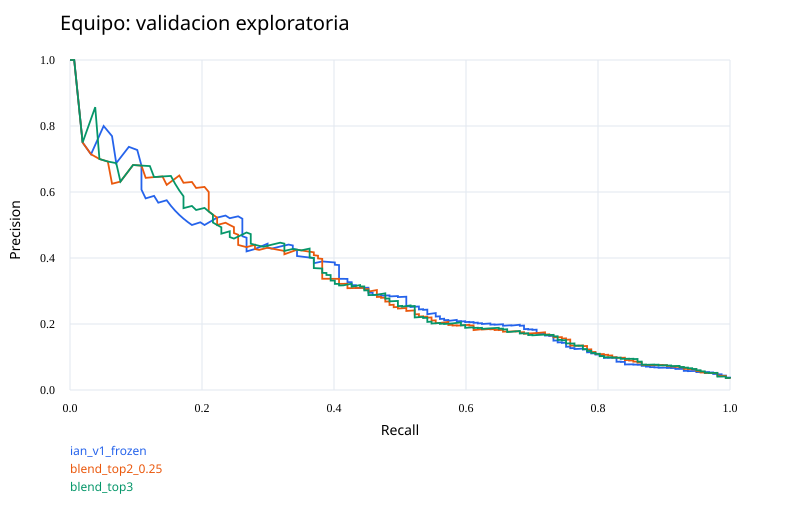

# Comparación del equipo y ensambles

**Solo validación. Test ya fue utilizado en la corrida anterior y no se consulta nuevamente.**

## Recomendación actual

**Conservar el modelo anterior (ian_v1). El nuevo ensamble no se recomienda como reemplazo.**

| Política en las mismas 4501 transacciones de validación | FP | FN | Costo |
|---|---:|---:|---:|
| Anterior, congelada | 99 | 94 | 19295 |
| Ensamble candidato, congelado antes de comprobar | 112 | 97 | 19960 |

El ensamble elegido combina 25% del LightGBM con variables seleccionadas y scores de Franco,
y 75% del LightGBM con el pool causal de Tomás. Se eligió por costo en policy_fit,
pero empeoró en el bloque posterior. No hay evidencia para prometer ahorro y menor fricción a la vez.
El bundle nuevo se conserva como **candidato experimental**, no como modelo promovido.

En búsqueda, el mejor individual fue selected_plus_franco_tpe (PR-AUC 0.4876);
el mejor ensamble por PR-AUC fue el promedio 50/50 (0.4941). La decisión de negocio no
coincide necesariamente con ese ranking. Entre familias de Franco, combinarlas rindió
mejor (0.2545) que usarlas por separado; PCA fue la mejor familia individual (0.1989).

Las 30 pruebas pasaron. Los resultados de test de ian_v1 permanecen intactos.

## Datos y reproducibilidad

CSV extraído del ZIP del curso a data/raw/fraud_dataset_v2.csv. La base coincide con make_dataset.py.
Se ejecutaron build_features.py y anomaly_detection.py. Se reconstruyeron las once variables
del reporte de selección guardado, sin repetir la selección sobre val.
Se corrigió el preprocesador de Franco: r/s son opcionales porque la ingesta oficial las elimina.
Los scores usan el mismo bundle original (PCA, IF, LOF, OCSVM y GMM), con ese ajuste de esquema.
El bundle original incluye score como predictor: no sirve como prueba de descubrimiento de fraude sin scoring.

## Protocolo

Train: 105000 filas. Val_search: 13499; calibración y ajuste de política dividen las siguientes 4500;
val_check: ultimas 4501. Los límites exactos y conteos se guardan en comparison.json.
Hiperparámetros y miembros del ensamble se eligen con val_search. Se prueban pesos prefijados.
Platt se ajusta en su bloque. Umbrales, pesos finales y candidato de negocio
se congelan con policy_fit antes de evaluar val_check. El límite propuesto es 100 FP por 4501 transacciones;
se escala al volumen de policy_fit. Es una hipótesis de capacidad, no una garantia en otras muestras.
Val ya participo en trabajos anteriores; esta comparación es exploratoria y no sustituye un nuevo test.

## Comparación predictiva en val_search

| Modelo | PR-AUC | AP | ROC-AUC |
|---|---:|---:|---:|
| blend_top2_0.5 | 0.4941 | 0.4944 | 0.8911 |
| blend_top3 | 0.4939 | 0.4942 | 0.8915 |
| blend_top2_0.75 | 0.4928 | 0.4930 | 0.8887 |
| blend_top2_0.25 | 0.4924 | 0.4927 | 0.8923 |
| selected_plus_franco_tpe | 0.4876 | 0.4879 | 0.8849 |
| tomas_full_causal_tpe | 0.4870 | 0.4873 | 0.8923 |
| tomas_full_causal_cmaes | 0.4861 | 0.4865 | 0.8901 |
| selected_plus_franco_cmaes | 0.4854 | 0.4857 | 0.8889 |
| ian_v1_model | 0.4852 | 0.4855 | 0.8915 |
| full_plus_franco_cmaes | 0.4841 | 0.4844 | 0.8902 |
| full_plus_franco_tpe | 0.4833 | 0.4836 | 0.8896 |
| hist_gradient | 0.4822 | 0.4825 | 0.8898 |
| tomas_selected_official | 0.4814 | 0.4817 | 0.8915 |
| selected_plus_franco | 0.4799 | 0.4802 | 0.8906 |
| tomas_full_causal | 0.4754 | 0.4757 | 0.8902 |
| full_plus_franco | 0.4752 | 0.4755 | 0.8889 |
| random_forest | 0.4465 | 0.4468 | 0.8751 |
| franco_all_scores | 0.2545 | 0.2556 | 0.7938 |
| franco_consolidator | 0.2545 | 0.2556 | 0.7938 |
| franco_pca | 0.1989 | 0.1971 | 0.7375 |
| franco_gmm | 0.1400 | 0.1312 | 0.7289 |
| franco_iforest | 0.1257 | 0.1302 | 0.7373 |
| franco_ocsvm | 0.1125 | 0.1127 | 0.6962 |
| franco_lof | 0.0885 | 0.0878 | 0.6372 |

## Decisión de negocio congelada antes de val_check

Candidato elegido: **blend_top2_0.25**. Menor costo con el límite de FP en policy_fit; desempate por PR-AUC.
Función: 5 x FP + 200 x FN. Precision mide cuantas alertas son fraude; recall cuantos fraudes se detectan.
Bloquear una compra legitima no equivale a perder un cliente: no hay etiquetas de churn para medirlo.

## Evaluación diagnóstica en val_check

| Modelo | PR-AUC | Umbral | FP | FN | Precision | Recall | Costo |
|---|---:|---:|---:|---:|---:|---:|---:|
| ian_v1_model | 0.3245 | 0.21843 | 98 | 95 | 0.388 | 0.395 | 19,490 |
| franco_pca | 0.1339 | 0.25481 | 97 | 133 | 0.198 | 0.153 | 27,085 |
| franco_iforest | 0.0668 | 0.11418 | 164 | 142 | 0.084 | 0.096 | 29,220 |
| franco_lof | 0.0464 | 0.11639 | 109 | 150 | 0.060 | 0.045 | 30,545 |
| franco_ocsvm | 0.0588 | 0.19003 | 122 | 146 | 0.083 | 0.070 | 29,810 |
| franco_gmm | 0.0862 | 0.18870 | 98 | 137 | 0.169 | 0.127 | 27,890 |
| franco_all_scores | 0.1630 | 0.24287 | 96 | 123 | 0.262 | 0.217 | 25,080 |
| tomas_selected_official | 0.3283 | 0.18030 | 129 | 91 | 0.338 | 0.420 | 18,845 |
| tomas_full_causal | 0.3156 | 0.19019 | 128 | 92 | 0.337 | 0.414 | 19,040 |
| tomas_full_causal_tpe | 0.3183 | 0.19277 | 127 | 92 | 0.339 | 0.414 | 19,035 |
| tomas_full_causal_cmaes | 0.3175 | 0.21982 | 118 | 98 | 0.333 | 0.376 | 20,190 |
| selected_plus_franco | 0.3188 | 0.18330 | 130 | 93 | 0.330 | 0.408 | 19,250 |
| selected_plus_franco_tpe | 0.3101 | 0.19953 | 116 | 95 | 0.348 | 0.395 | 19,580 |
| selected_plus_franco_cmaes | 0.3231 | 0.19298 | 132 | 92 | 0.330 | 0.414 | 19,060 |
| full_plus_franco | 0.3096 | 0.18330 | 134 | 93 | 0.323 | 0.408 | 19,270 |
| full_plus_franco_tpe | 0.3230 | 0.20135 | 128 | 94 | 0.330 | 0.401 | 19,440 |
| full_plus_franco_cmaes | 0.3092 | 0.18752 | 124 | 95 | 0.333 | 0.395 | 19,620 |
| franco_consolidator | 0.1630 | 0.24287 | 96 | 123 | 0.262 | 0.217 | 25,080 |
| random_forest | 0.3030 | 0.16690 | 156 | 94 | 0.288 | 0.401 | 19,580 |
| hist_gradient | 0.3369 | 0.20550 | 118 | 92 | 0.355 | 0.414 | 18,990 |
| blend_top3 | 0.3234 | 0.20305 | 113 | 96 | 0.351 | 0.389 | 19,765 |
| blend_top2_0.25 | 0.3228 | 0.20435 | 112 | 97 | 0.349 | 0.382 | 19,960 |
| blend_top2_0.5 | 0.3210 | 0.19311 | 122 | 94 | 0.341 | 0.401 | 19,410 |
| blend_top2_0.75 | 0.3187 | 0.21486 | 102 | 97 | 0.370 | 0.382 | 19,910 |
| ian_v1_frozen | 0.3245 | 0.20581 | 99 | 94 | 0.389 | 0.401 | 19,295 |

## Resultado e implicaciones

Frente a la política anterior: ahorro observado -665; reducción de falsos positivos -13.
Valores negativos significan empeoramiento. No se cambia el candidato congelado despues de ver val_check.
No se promete eliminar todas las perdidas: subir la detección normalmente aumenta la fricción.
Intervalo exploratorio bootstrap pareado del ahorro (95%): -1,640 a 150.
El bootstrap de filas no modela dependencia temporal; no es una garantia de generalización.

## Sensibilidad: pesos monetarios y presupuesto de FP

| FP cost | Tope equivalente /4501 | Umbral fijado en policy_fit | FP val_check | FN val_check | Costo val_check |
|---|---:|---:|---:|---:|---:|
| 5.0 | 50 | 0.27482 | 73 | 103 | 20,965 |
| 5.0 | 100 | 0.20435 | 112 | 97 | 19,960 |
| 5.0 | 200 | 0.15149 | 186 | 84 | 17,730 |
| 5.0 | 500 | 0.06075 | 553 | 44 | 11,565 |
| 10.0 | 50 | 0.27482 | 73 | 103 | 21,330 |
| 10.0 | 100 | 0.20435 | 112 | 97 | 20,520 |
| 10.0 | 200 | 0.20435 | 112 | 97 | 20,520 |
| 10.0 | 500 | 0.06075 | 553 | 44 | 14,330 |
| 20.0 | 50 | 0.27482 | 73 | 103 | 22,060 |
| 20.0 | 100 | 0.20435 | 112 | 97 | 21,640 |
| 20.0 | 200 | 0.20435 | 112 | 97 | 21,640 |
| 20.0 | 500 | 0.20435 | 112 | 97 | 21,640 |

## Protecciones y límites

- No se usa el consolidador supervisado de Franco como feature de entrenamiento in-sample.
  Se evalúa directamente como modelo independiente y se permite en mezclas de predicciones de validación.
- El pool causal excluye te_j_bayes (KFold aleatorio) y las dos variables de velocidad con empates temporales.
  score_texto_nb se sustituye por la version temporal sin prior futuro de Ian.
- tomas_selected_official reproduce las columnas originales para trazabilidad; no participa como candidato
  de negocio final por el problema documentado del prior de texto. Los originales no se sobrescriben.
- El modelo anterior usa su calibrador/umbral congelados; había ajustado ese umbral en val_check anteriormente.
  Tiene una ventaja metodológica: no interpretar esta muestra como prueba independiente.
- Los miembros del promedio se entrenan en train y se preseleccionan por val_search.
  La elección final entre los pesos prefijados usa policy_fit, nunca val_check.
- Mantener ian_v1 como referencia. Para reemplazarlo con evidencia independiente hace falta un período nuevo.
- El costo FP de 5 cubre contacto; no incluye churn, reputacion ni margen perdido. Se explora subirlo a 10/20.
- En producción, derivar riesgo intermedio a verificacion podria reducir fricción; falta medir su efectividad
  y costo, por lo que no se contabiliza como ahorro demostrado.

## Reproducir

```powershell
.\run.bat src/features/build_features.py
.\run.bat src/models/anomaly_detection.py
.\run.bat src/models/compare_team.py --output models/supervised/team_v2 --trials 12 --seed 42
```

En esta máquina sigue sin estar disponible el launcher py/3.14; se ejecutó con .venv Python 3.12.14
y las dependencias fijadas. No se modificó .python-version.

Artefactos: comparison.json, trials_*.json, selected_bundle.joblib, predicciones val_check,
curvas y políticas en la carpeta de corrida. No hay commits ni push.


