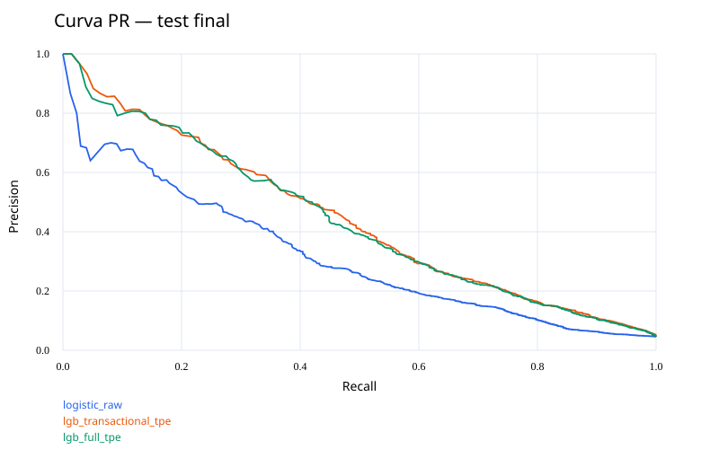
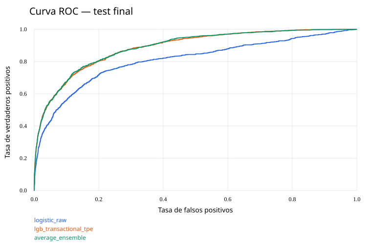

# Resultados de modelado — Ian

Corrida: `models\supervised\ian_v1`. Semilla: 42.
Modelo elegido **solo con val_search**: `lgb_transactional_tpe`.

## Comparación de búsqueda (val_search)

| Modelo | PR-AUC | AP | ROC-AUC |
|---|---:|---:|---:|
| lgb_transactional_tpe | 0.4852 | 0.4855 | 0.8915 |
| lgb_full_tpe | 0.4849 | 0.4853 | 0.8886 |
| lgb_full_cmaes | 0.4846 | 0.4849 | 0.8905 |
| lgb_transactional_cmaes | 0.4835 | 0.4838 | 0.8915 |
| lgb_reference_transactional | 0.4808 | 0.4811 | 0.8924 |
| average_ensemble | 0.4803 | 0.4806 | 0.8912 |
| lgb_reference_full | 0.4745 | 0.4748 | 0.8913 |
| lgb_raw_tpe | 0.4614 | 0.4618 | 0.8902 |
| lgb_raw_cmaes | 0.4565 | 0.4569 | 0.8867 |
| lgb_reference_raw | 0.4483 | 0.4488 | 0.8882 |
| logistic_raw | 0.3319 | 0.3328 | 0.7789 |

## Búsquedas

| Estudio | Trials | Podados | Mejor PR-AUC | Segundos |
|---|---:|---:|---:|---:|
| trials_full_cmaes | 20 | 12 | 0.4846 | 47.2 |
| trials_full_tpe | 20 | 11 | 0.4849 | 63.8 |
| trials_raw_cmaes | 20 | 12 | 0.4565 | 35.7 |
| trials_raw_tpe | 20 | 10 | 0.4614 | 47.3 |
| trials_transactional_cmaes | 20 | 12 | 0.4835 | 33.7 |
| trials_transactional_tpe | 20 | 11 | 0.4852 | 45.7 |

## Negocio — test final

Costo principal: FP=5, FN=200. Umbrales elegidos en val_policy, máximo 100 FP en ese bloque.

| Modelo | PR-AUC calibrado | Umbral | Precision | Recall | FP | FN | Costo | Ahorro vs permitir todo |
|---|---:|---:|---:|---:|---:|---:|---:|---:|
| logistic_raw | 0.3150 | 0.25132 | 0.415 | 0.334 | 487 | 690 | 140,435 | 66,765 |
| lgb_reference_raw | 0.4313 | 0.23101 | 0.493 | 0.416 | 443 | 605 | 123,215 | 83,985 |
| lgb_raw_tpe | 0.4337 | 0.22384 | 0.478 | 0.426 | 482 | 595 | 121,410 | 85,790 |
| lgb_raw_cmaes | 0.4354 | 0.21601 | 0.469 | 0.427 | 500 | 594 | 121,300 | 85,900 |
| lgb_reference_transactional | 0.4362 | 0.20929 | 0.465 | 0.433 | 517 | 587 | 119,985 | 87,215 |
| lgb_transactional_tpe | 0.4432 | 0.20581 | 0.472 | 0.457 | 530 | 563 | 115,250 | 91,950 |
| lgb_transactional_cmaes | 0.4361 | 0.20575 | 0.471 | 0.434 | 505 | 586 | 119,725 | 87,475 |
| lgb_reference_full | 0.4357 | 0.21398 | 0.473 | 0.417 | 482 | 604 | 123,210 | 83,990 |
| lgb_full_tpe | 0.4368 | 0.22035 | 0.487 | 0.427 | 466 | 594 | 121,130 | 86,070 |
| lgb_full_cmaes | 0.4399 | 0.20918 | 0.478 | 0.442 | 500 | 578 | 118,100 | 89,100 |
| average_ensemble | 0.4436 | 0.21770 | 0.473 | 0.439 | 506 | 581 | 118,730 | 88,470 |

## Interpretación

El modelo elegido detecta 45.7% de los fraudes con precision 47.2% en test final.
Su costo es 115,250, frente a 140,435 de la regresión logística bajo las políticas congeladas.
La diferencia de costo frente a logística es 25,185; un valor negativo significa que el ganador por PR-AUC cuesta más.
El ganador por PR-AUC no necesariamente minimiza el costo con una restricción operativa. No se cambia de ganador por observar test.
Calibración del ganador: Brier sin calibrar 0.032846, con Platt 0.032881.

### Sensibilidad del ganador

| Costo FP | Umbral congelado | FP | FN | Costo total |
|---|---:|---:|---:|---:|
| 5.0 | 0.20581 | 530 | 563 | 115,250 |
| 10.0 | 0.20581 | 530 | 563 | 117,900 |
| 20.0 | 0.20581 | 530 | 563 | 123,200 |

### Variables principales (gain, no causalidad)

- `o`: 134,845.3.
- `score`: 126,067.6.
- `ratio_monto_l`: 31,694.9.
- `ratio_d_m`: 21,095.5.
- `g`: 18,547.4.
- `score_texto_nb`: 16,768.9.
- `prod_b_log_c`: 13,836.4.
- `ratio_monto_e`: 11,487.3.

## Límites y próximos pasos

La selección previa de variables ya había consultado val; las cifras de búsqueda son exploratorias.
Se usó Python 3.12.14 con dependencias fijadas; falta verificar el entorno oficial 3.14.
Los scores de anomalía son la alternativa IF/PCA/kNN de Ian, no la entrega completa de Franco.
Costos del período evaluado, sin extrapolación mensual. El tope de FP de validación no es una garantía para otro período.
Antes de producción: acordar capacidad real de revisión, monitorear calibración y deriva, medir costos de contacto y pérdida de clientes.
Datos adicionales deseables: identidad de usuario/dispositivo, historial causal, chargebacks confirmados y fecha de confirmación de etiqueta.
No usar resultados finales para una nueva ronda de ajuste: se necesitaría otro período fuera de muestra.

