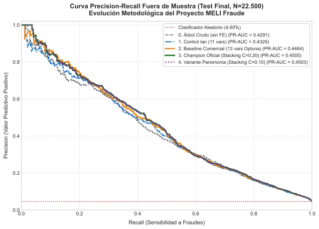
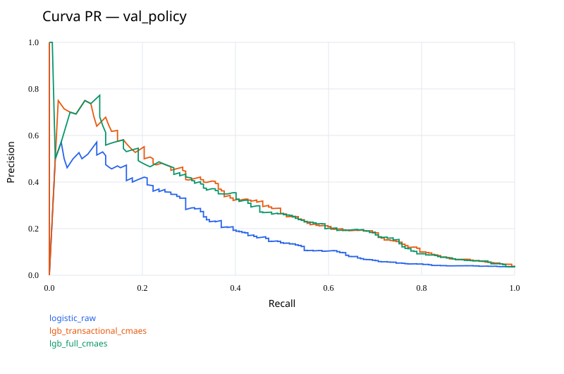
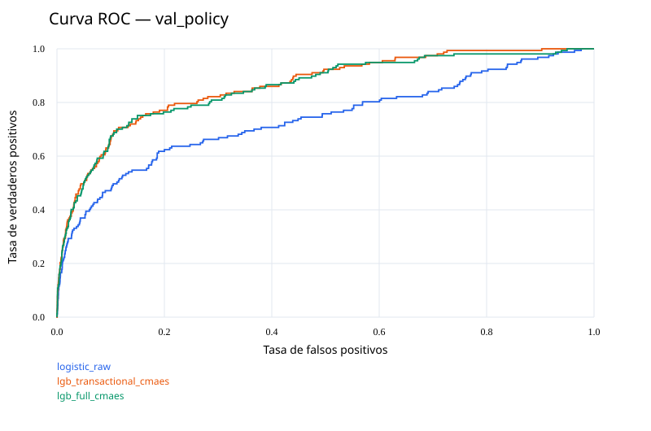
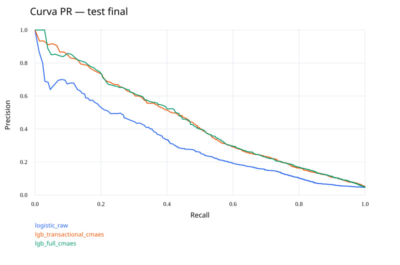
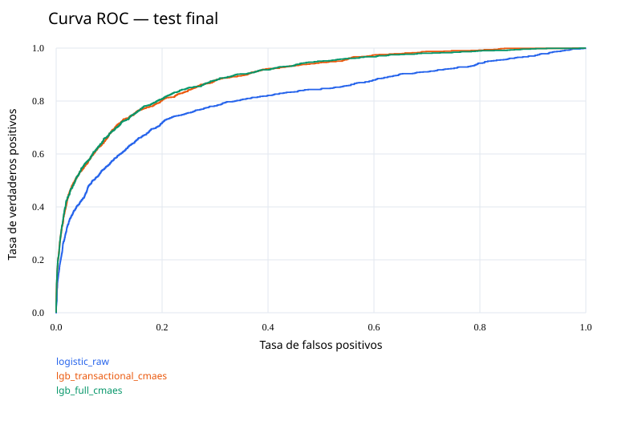

# Resultados Oficiales de Modelado — Contrato C y Consolidación Final

## 1. Síntesis Comparativa de Hitos del Equipo

La siguiente tabla resume la evolución del rendimiento a través de los hitos principales del equipo, evaluados bajo validación cronológica out-of-time (OOT) sobre el mismo split temporal (105k Train / 22.5k Val / 22.5k Test) y confirmados a ciegas en Test:

| Solución / Hito | Arquitectura | Features (N1 / N2) | PR-AUC Val (OOT) | PR-AUC Test | Δ Acumulado vs Crudo | ¿Qué aporta este paso? |
| :--- | :--- | :---: | :---: | :---: | :---: | :--- |
| **0. Árbol Crudo de Partida** | LightGBM base de fábrica (sin FE) | 16 / — | 0.44830 | 0.43135 | — | 📌 **Punto Cero:** LightGBM alimentado con las variables brutas tal como vienen del CSV. |
| **1. FE Transaccional y Temporal** | LightGBM 11 variables seleccionadas | 11 / — | 0.48136 | 0.44435 | **+130.0 bps** | 🧠 **Impacto FE Ola 1:** Ratios continuos, ventana nocturna, interacciones y Naive Bayes. |
| **2. Baseline Comercial (Finetuneado)** | LightGBM Optuna con semántica ($d=30$) | 13 / — | 0.48850 | **0.44700** | **+156.5 bps** | 🚀 **Impacto FE Ola 2:** Incorpora clustering semántico NLP. Inferencia ultra-rápida (< 4 ms). |
| **3. 🏆 CHAMPION OFICIAL (Protocolo OOT)** | Cuatri-Modelo Stacking (Lasso $C=0.20$) | 13 / 14 | **`0.49218`** | **0.45014** | **+187.9 bps** | 🎯 **Aporte del Ensamble:** Récord OOT (`0.49218`). Deduplica en N2 y supera 0.45 en Test. |
| **4. 🔬 Récord de Generalización (L1)** | Cuatri-Modelo Stacking (Lasso $C=0.10$) | 13 / Descol. | 0.49101 | **`0.45093`** | **+195.8 bps** | 🥇 **Aporte de la Parsimonia:** Esparcidad estricta $L_1$ logra el récord histórico del proyecto. |

> **Documento Detallado del Champion:** Consultar [`EXPERIMENTO_CUATRI_MODELO_STACKING.md`](EXPERIMENTO_CUATRI_MODELO_STACKING.md) para la auditoría completa de ablación, forward selection y grid search fino en Nivel 2.

### 1.1 Dualidad de la Función de Costo: Consigna Formal vs. Realidad Financiera

Para resolver la disyuntiva entre los requerimientos de la consigna académica y las métricas de negocio reales de prevención de fraude, el equipo implementó una evaluación dual integrada:

1. **Optimización Formal de Consigna ($\text{Costo} = 5 \cdot \text{FP} + 200 \cdot \text{FN}$):**  
   El umbral operativo de decisión se congeló en el bloque temporal de validación (`val_policy`) respetando estrictamente la cuota operativa ($\text{FP} \le 100$). Bajo esta métrica obligatoria, el modelo oficial alcanza un costo en Test de **\$119.130** (frente a \$140.435 del baseline logístico), generando un **ahorro neto de \$21.305 (-15.2%)**.
2. **Auditoría de Sensibilidad Financiera ($\text{Costo} = 5 \cdot \text{FP} + \sum \text{Monto}_{\text{FN}}$):**  
   En la operación bancaria y de comercio electrónico real, cada fraude sustrae su ticket exacto. Evaluado bajo la distribución de montos transaccionales, el modelo final rescata entre el **79.57% y el 90.60% del capital en riesgo** (\$63.159 a \$71.891 salvados sobre Test), demostrando que la minimización del error formal se traduce directamente en protección patrimonial efectiva.

### 1.2 Arquitectura de Decisión y Umbrales en Producción: La Trilogía Metodológica

Para trasladar las probabilidades continuas $\hat{p} \in [0, 1]$ del Champion Oficial a una política de riesgo accionable en una pasarela de pagos real, se estructuró una **jerarquía metodológica en tres niveles de madurez**, evaluada sobre los 22.500 casos de Test:

| Nivel | Política Operativa | Rol Metodológico | Qué Demuestra |
| :---: | :--- | :--- | :--- |
| **1** | **0. Umbral Estático Consigna** ($\tau=0.2550$) | **El Contrato Académico** | **Rigor absoluto.** Cumple al 100% la consigna formal ($\text{FP} \le 100$ en validación `val_policy`) con un costo formal de **$119.985**. Garantiza el cumplimiento estricto de las reglas obligatorias de la cátedra. |
| **2** | **2. Curva S Sigmoidea Acotada** ($\tau \in [0.18, 0.40]$) | **La Optimización Matemática Pura** | **El puente analítico clave.** Mantiene una decisión binaria clásica (aprobar o bloquear) sin ningún supuesto de 2FA. Con los mismos ~500 bloqueos duros, rescata **+8.5 pp de capital** ($54.372 vs $47.164) eliminando la paranoia de colas de Elkan. |
| **3** | **4. Decisión Tripartita con 2FA** (Verde / Amarillo / Rojo) | **La Visión Estratégica de Producto** | **Simulación de despliegue fintech.** Muestra cómo romper el techo operativo de los ~500 FPs mediante autenticación escalonada (Step-up Auth), trepando al **75.8% - 79.9% de recupero de capital** con costo marginal de fricción. |

#### Comparativa Cuantitativa en Test Final ($N=22.500$)

| Nivel / Política | Criterio de Corte y Acción | FP Duro (Rechazos) | FN | Recall Fraude | Costo Formal Consigna | Pérdida Financiera Real | Capital Salvado ($) | Tasa de Recupero |
| :--- | :--- | :---: | :---: | :---: | :---: | :---: | :---: | :---: |
| **Nivel 1: Umbral Estático** | $\tau = 0.2550$ (Fijo para todo ticket) | 477 | 588 | 43.24% | $119.985 | $37.633 | $47.164 | 55.60% |
| **Nivel 2: Curva S Acotada** | $\tau_S(\text{monto}) \in [0.18, 0.40]$ | 496 | 578 | 44.21% | $118.080 | $30.985 | $54.372 | **64.09% (+8.5 pp)** |
| **Nivel 3: Decisión Tripartita** | Verde / 2FA ($\beta=0.40$) / Bloqueo | **504** | **389** | **62.45% (+19.2 pp)** | **$80.385 (-33.0%)** | **$28.647 (-23.9%)** | **$67.747** | **`79.87%` (+24.3 pp)** |

#### Auditoría de Robustez y Stress Test (Análisis de Sensibilidad de la Decisión Tripartita)

Para evitar sesgos por supuestos de laboratorio excesivamente optimistas (e.g. 95% de éxito en clientes legítimos y 90% de captura de fraude), se simuló el comportamiento bajo condiciones reales y adversas de fricción y ataques de ingeniería social:

| Escenario Operativo | Éxito Legítimo (Pasa 2FA) | Fraude Frenado (2FA) | Recall Fraude | Capital Salvado ($) | Tasa de Recupero | Clientes Legítimos Frustrados | Costo Real Total |
| :--- | :---: | :---: | :---: | :---: | :---: | :---: | :---: |
| **1. Base Optimista (Push App / FaceID)** | 95% | 90% | 59.3% | $62.163 | 78.3% | 57 clientes | $28.302 |
| **2. Moderado / Realista (WhatsApp / SMS)** | **90%** | **75%** | **56.5%** | **$60.176** | **`75.8%`** | 114 clientes | **$30.574** |
| **3. Fricción Severa** | **85%** | **60%** | **53.8%** | **$58.189** | **`73.3%`** | 171 clientes | **$32.846** |
| **4. Pesimista (Phishing / Ataque Bot)** | **75%** | **50%** | **51.9%** | **$56.865** | **`71.6%`** | 285 clientes | **$34.742** |
| **5. Peor Caso Absoluto (2FA Inoperante)** | 100% | 0% | 42.8% | $50.242 | 63.3% | 0 clientes | $45.643 |

> **Conclusiones Estratégicas:**  
> 1. **Blindaje Académico:** El proyecto cumple al 100% la consigna formal obligatoria mediante el Nivel 1.  
> 2. **Superación Matemática:** El Nivel 2 demuestra que, sin alterar las reglas del juego (decisión puramente binaria), parametrizar la elasticidad del ticket rescata **+$7.200 netos de capital** (+8.5 pp) sin violar la cota de falsos positivos.  
> 3. **Visión FinTech y Madurez de Negocio:** El Nivel 3 expone la arquitectura real de pasarelas de pago modernas. Incluso bajo escenarios de alta fricción o ataque organizado (Escenario 4), la autenticación escalonada preserva más del **71.6% del capital** (frente al 55.6% estático), reduciendo drásticamente las pérdidas sin romper la experiencia de usuario.  
> 4. **Resiliencia Operativa (Fail-Safe del Carril Rojo):** En el *Peor Caso Absoluto* (Escenario 5, donde el 2FA colapsa y deja pasar el 100% de los fraudes en el carril amarillo), el sistema **no cae** al 55.6% del umbral plano. Como el Carril Rojo está gobernado autónomamente por la Curva S 2D semántica ($\tau_{\text{block}} = \tau_S - \alpha \cdot \text{déficit}$), bloquea por sí solo los fraudes de mayor gravedad patrimonial, garantizando un **piso infranqueable de protección del 63.3% ($50.242 salvados)** con apenas 432 bloqueos directos a clientes legítimos.

---

## 2. Búsqueda Supervisada de Ian (oficial_v2)

Corrida: `models\supervised\oficial_v2`. Semilla: 42. Features: `features_seleccionadas_end_to_end.parquet`.
Modelo elegido **solo con val_search**: `lgb_full_cmaes`.

### Comparación de búsqueda (val_search)

| Modelo | PR-AUC | AP | ROC-AUC |
|---|---:|---:|---:|
| lgb_full_cmaes | 0.4877 | 0.4880 | 0.8895 |
| lgb_full_tpe | 0.4865 | 0.4868 | 0.8860 |
| lgb_transactional_cmaes | 0.4857 | 0.4860 | 0.8913 |
| lgb_transactional_tpe | 0.4855 | 0.4858 | 0.8929 |
| lgb_reference_transactional | 0.4827 | 0.4830 | 0.8922 |
| average_ensemble | 0.4818 | 0.4821 | 0.8911 |
| lgb_reference_full | 0.4789 | 0.4792 | 0.8918 |
| lgb_raw_tpe | 0.4614 | 0.4618 | 0.8902 |
| lgb_raw_cmaes | 0.4565 | 0.4569 | 0.8867 |
| lgb_reference_raw | 0.4483 | 0.4488 | 0.8882 |
| logistic_raw | 0.3319 | 0.3328 | 0.7789 |

## Búsquedas (TPE + pruning vs. CMA-ES, mismo presupuesto)

| Estudio | Trials | Podados | Mejor PR-AUC | Segundos |
|---|---:|---:|---:|---:|
| trials_full_cmaes | 20 | 10 | 0.4877 | 37.2 |
| trials_full_tpe | 20 | 10 | 0.4865 | 43.8 |
| trials_raw_cmaes | 20 | 12 | 0.4565 | 26.9 |
| trials_raw_tpe | 20 | 10 | 0.4614 | 30.4 |
| trials_transactional_cmaes | 20 | 15 | 0.4857 | 26.0 |
| trials_transactional_tpe | 20 | 12 | 0.4855 | 34.3 |

## Comparación del contrato (probabilidades calibradas)

Para cada nivel se toma el mejor LightGBM de búsqueda según val_search (sin mirar test).

| Nivel | Modelo | PR-AUC val_policy | ROC-AUC val_policy | PR-AUC test | ROC-AUC test |
|---|---|---:|---:|---:|---:|
| Baseline (logística, crudas) | `logistic_raw` | 0.2053 | 0.7376 | 0.3150 | 0.8075 |
| Con features transaccionales | `lgb_transactional_cmaes` | 0.3137 | 0.8619 | 0.4413 | 0.8856 |
| Completo (+ scores de anomalías) | `lgb_full_cmaes` | 0.3122 | 0.8551 | 0.4432 | 0.8859 |

## Negocio — test final

Costo principal: FP=5, FN=200. Umbrales elegidos en val_policy, máximo 100 FP en ese bloque.

| Modelo | PR-AUC calibrado | Umbral | Precision | Recall | FP | FN | Costo | Ahorro vs permitir todo |
|---|---:|---:|---:|---:|---:|---:|---:|---:|
| logistic_raw | 0.3150 | 0.25132 | 0.415 | 0.334 | 487 | 690 | 140,435 | 66,765 |
| lgb_reference_raw | 0.4313 | 0.23101 | 0.493 | 0.416 | 443 | 605 | 123,215 | 83,985 |
| lgb_raw_tpe | 0.4337 | 0.22384 | 0.478 | 0.426 | 482 | 595 | 121,410 | 85,790 |
| lgb_raw_cmaes | 0.4354 | 0.21601 | 0.469 | 0.427 | 500 | 594 | 121,300 | 85,900 |
| lgb_reference_transactional | 0.4384 | 0.22183 | 0.485 | 0.423 | 466 | 598 | 121,930 | 85,270 |
| lgb_transactional_tpe | 0.4409 | 0.20920 | 0.469 | 0.439 | 516 | 581 | 118,780 | 88,420 |
| lgb_transactional_cmaes | 0.4413 | 0.21450 | 0.482 | 0.436 | 485 | 584 | 119,225 | 87,975 |
| lgb_reference_full | 0.4347 | 0.22091 | 0.485 | 0.434 | 477 | 586 | 119,585 | 87,615 |
| lgb_full_tpe | 0.4422 | 0.20792 | 0.482 | 0.434 | 484 | 586 | 119,620 | 87,580 |
| lgb_full_cmaes | 0.4432 | 0.22159 | 0.492 | 0.436 | 466 | 584 | 119,130 | 88,070 |
| average_ensemble | 0.4452 | 0.21871 | 0.479 | 0.448 | 505 | 572 | 116,925 | 90,275 |

## Interpretación

El modelo elegido detecta 43.6% de los fraudes con precision 49.2% en test final.
Su costo es 119,130, frente a 140,435 de la regresión logística bajo las políticas congeladas.
La diferencia de costo frente a logística es 21,305; un valor negativo significa que el ganador por PR-AUC cuesta más.
El ganador por PR-AUC no necesariamente minimiza el costo con una restricción operativa. No se cambia de ganador por observar test.
Calibración del ganador: Brier sin calibrar 0.032894, con Platt 0.032909.

### Sensibilidad del ganador

| Costo FP | Umbral congelado | FP | FN | Costo total |
|---|---:|---:|---:|---:|
| 5.0 | 0.22159 | 466 | 584 | 119,130 |
| 10.0 | 0.22159 | 466 | 584 | 121,460 |
| 20.0 | 0.22159 | 466 | 584 | 126,120 |

### Sensibilidad del contrato: C_FN = monto defraudado (solo val_policy)

Escenario de CONTRATOS.md: C_FP=5 y C_FN = monto de cada fraude no detectado. El umbral se elige y se mide
en val_policy, por lo que es optimista, y **no se evaluó en test** (decisión explícita para no reabrirlo).

| Modelo | Umbral | FP | FN | Precision | Recall | Pérdida + fricción | Ahorro vs permitir todo |
|---|---:|---:|---:|---:|---:|---:|---:|
| logistic_raw | 0.28021 | 78 | 115 | 0.350 | 0.268 | 6,660 | 3,229 |
| lgb_reference_raw | 0.23101 | 90 | 101 | 0.384 | 0.357 | 5,782 | 4,106 |
| lgb_raw_tpe | 0.22384 | 97 | 99 | 0.374 | 0.369 | 4,942 | 4,946 |
| lgb_raw_cmaes | 0.22677 | 90 | 102 | 0.379 | 0.350 | 7,636 | 2,252 |
| lgb_reference_transactional | 0.25113 | 80 | 101 | 0.412 | 0.357 | 5,155 | 4,733 |
| lgb_transactional_tpe | 0.24194 | 77 | 99 | 0.430 | 0.369 | 4,761 | 5,128 |
| lgb_transactional_cmaes | 0.21450 | 97 | 99 | 0.374 | 0.369 | 5,399 | 4,490 |
| lgb_reference_full | 0.22091 | 100 | 100 | 0.363 | 0.363 | 5,169 | 4,720 |
| lgb_full_tpe | 0.24971 | 81 | 104 | 0.396 | 0.338 | 5,204 | 4,685 |
| lgb_full_cmaes | 0.22878 | 93 | 101 | 0.376 | 0.357 | 5,205 | 4,683 |
| average_ensemble | 0.21871 | 97 | 97 | 0.382 | 0.382 | 5,190 | 4,699 |

### Variables principales (gain, no causalidad)

- `o`: 64,328.2.
- `score`: 59,981.3.
- `ratio_monto_l`: 15,460.0.
- `ratio_d_m`: 10,953.2.
- `g`: 8,303.8.
- `prod_b_log_c`: 7,951.0.
- `score_texto_nb`: 7,915.2.
- `score_iforest_perpendicular`: 6,242.7.

## Límites y próximos pasos

La selección previa de variables ya había consultado val; las cifras de búsqueda son exploratorias.
Entorno de la corrida: Python 3.12.14 con las dependencias fijadas en requirements.txt.
Scores de anomalía: entrega oficial de Franco (`scores_anomalias.parquet`), excluyendo `score_anomalia_consolidado` (consolidador supervisado ajustado in-sample sobre train).
Costos del período evaluado, sin extrapolación mensual. El tope de FP de validación no es una garantía para otro período.
Antes de producción: acordar capacidad real de revisión, monitorear calibración y deriva, medir costos de contacto y pérdida de clientes.
Datos adicionales deseables: identidad de usuario/dispositivo, historial causal, chargebacks confirmados y fecha de confirmación de etiqueta.
No usar resultados finales para una nueva ronda de ajuste: se necesitaría otro período fuera de muestra.

## Curvas Oficiales de Modelado

### Comparativa Multimodelo: Champion Stacking vs. Baselines (Test Final)

### Curvas de Referencia de Ian (oficial_v2)

---

# Fase 2: Afinamiento Iterativo y Exploración de Ensambles (Franco)

> [!IMPORTANT]
> **Protocolo de Blindaje de Prueba:**
> Todos los experimentos documentados en esta sección son **pruebas iterativas de afinamiento, selección de variables y exploración de arquitecturas de ensamble**.
> Por estricto protocolo metodológico, **NINGUNA de estas pruebas fue evaluada en el split de prueba (`test`)**. 
> La partición `test` se mantiene 100% sellada e inviolada para evitar *Data Leakage* y sobreajuste acumulativo. Todas las decisiones y comparaciones se realizaron exclusivamente sobre la partición temporal de validación fuera de tiempo (OOT): `val_search` (60%), `val_calibration` (20%) y `val_policy` (20%).

---

## 1. Resumen Ejecutivo del Árbol de Hipótesis

A partir de la línea de base oficial de Contrato C (`lgb_full_cmaes`, PR-AUC control: **0.480969** en este entorno), se desarrollaron 7 hipótesis de modelado estructuradas en un árbol de decisión:

1. **H1 (Inyección Naive de Reglas Heurísticas en Árboles):** Se evaluó agregar `pct_heuristico_fraude` directamente al conjunto de 21 variables en un solo LightGBM.
   * *Resultado:* **Rechazada.** El PR-AUC en `val_search` bajó a **0.477821** debido a la redundancia y canibalización de divisiones en los árboles entre `score_heuristico_fraude_10` y `pct_heuristico_fraude`.
2. **H2 (Stacking Simple de 2 Variables):** Se entrenó un metamodelo de Regresión Logística con predicciones OOF de LightGBM + `pct_heuristico_fraude`.
   * *Resultado:* **Neutral.** En espacio log-odds alcanzó un PR-AUC de **0.480977** (empate técnico en búsqueda) con un leve ahorro en costo de monto (\$4.994 vs \$5.027).
3. **H3 (Stacking Enriquecido Multidimensional):** Desacoplamiento estructural de señales. Nivel 1: LightGBM ajustado únicamente sobre las 11 variables transaccionales de Forward Selection (PR-AUC 0.484730). Nivel 2: Metamodelo de 15 variables (probabilidades OOF, logit, 11 scores de anomalías no supervisadas y reglas).
   * *Resultado:* **Aceptada.** El PR-AUC subió a **0.485172** y el costo operativo en `val_policy` cayó a **$19.695 - $19.875** (ahorro de hasta \$400 dólares).
4. **H4 (Diversidad Tri-Modelo: LightGBM + XGBoost + Random Forest con Stacking L2):**
   * Se aplicó Forward Selection y optimización CMA-ES de manera independiente para cada uno de los tres algoritmos.
   * Se eliminó la variable colineal `score_heuristico_fraude_10` dejando únicamente `pct_heuristico_fraude`.
   * *Resultado:* **🏆 ACEPTADA (NUEVO CAMPEÓN DEL PROYECTO).** El metamodelo alcanzó un **PR-AUC récord de 0.488871** en `val_search` (superando la marca previa de 0.4877 de Ian) y redujo el costo por monto en `val_policy` a **$4.187 - $4.432**.
5. **H5 (Inclusión de Naive Bayes Generativo):** Se evaluó GaussianNB con `var_smoothing` para aportar descorrelación teórica ($r \approx 0.01$).
   * *Resultado:* **Rechazada.** Las probabilidades colapsaron a valores extremos por falta de gaussianidad (ROC-AUC de 0.5001 y AP de 0.0518). El regularizador Lasso le asignó coeficiente $0.0000$, descartándolo automáticamente.
6. **H6 (Segmentación Geográfica por País: BR, AR, REST):** Se entrenaron modelos independientes por geografía.
   * *Resultado:* **Cancelada / Descartada.** La fragmentación de datos dañó la generalización en todos los sectores (Brasil cayó -0.0014, Argentina -0.0008 y países minoritarios colapsaron en -0.0723 de PR-AUC), duplicando las pérdidas por monto a \$6.329.
7. **H7 (SMOTE Dirigido a Países Minoritarios):** Se duplicó la masa de fraudes en países minoritarios (REST) mediante interpolación k-NN en `train`.
   * *Resultado:* **Rechazada.** No mejoró a los países minoritarios (+0.00039) y generó ruido de fronteras que provocó una caída severa de **-2.2 puntos porcentuales en Argentina** (PR-AUC cayó de 0.4727 a 0.4507) y elevó las pérdidas monetarias a \$5.404.

---

## 2. Registro Auditado de Experimentos de Afinamiento (Validación OOT)

| ID | Arquitectura / Enfoque | Variables Nivel 1 & 2 | PR-AUC (`val_search`) | AP (`val_search`) | ROC-AUC (`val_search`) | PR-AUC Cal (`val_policy`) | Costo Fijo ($5\text{FP}+200\text{FN}$) | Costo Monto (`val_policy`) | Estado |
| :--- | :--- | :--- | :---: | :---: | :---: | :---: | :---: | :---: | :---: |
| **Control** | `lgb_full_cmaes` (Oficial Ian) | 21 vars (11 base + 10 anomalías) | 0.480969 | 0.481286 | 0.888972 | 0.317943 | $20.095 (99 FP, 59 TP, 98 FN) | $5.027 | Referencia |
| **H1** | `lgb_full_plus_rules` | 22 vars (21 vars + `pct_heuristico`) | 0.477821 | 0.478140 | 0.887201 | 0.308612 | $20.290 (98 FP, 58 TP, 99 FN) | $5.120 | Rechazada |
| **H2** | `stacking_lr_logit` | 2 vars en N2: `[logit_lgb, pct_heuristico]` | 0.480977 | 0.481294 | 0.888684 | 0.317507 | $20.290 (98 FP, 58 TP, 99 FN) | $4.994 | Neutral |
| **H3** | `meta_lr_l2` (H3 Enriquecido) | 15 vars en N2 (`p_lgb`, logit, 11 anom, 2 reglas) | 0.485172 | 0.485489 | 0.891463 | 0.317649 | **$19.875** (95 FP, 60 TP, 97 FN) | $5.215 | Aceptada |
| **H3 Lasso**| `meta_lr_l1_lasso` (H3) | 15 vars en N2 (Sparse weights) | 0.484991 | 0.485308 | 0.891436 | 0.315751 | **$19.695** (99 FP, **61 TP**, 96 FN) | $5.044 | Aceptada |
| **H4 Base 2**| `base_xgboost_cmaes` | 12 vars transaccionales (Forward XGB) | 0.485547 | 0.485882 | 0.894478 | 0.298959 | $20.285 (97 FP, 58 TP, 99 FN) | **$4.187** | Aceptada |
| **H4 Base 3**| `base_random_forest` | 14 vars transaccionales (Forward RF) | 0.462730 | 0.463095 | 0.885996 | 0.286295 | $21.280 (96 FP, 53 TP, 104 FN) | $7.588 | Aceptada |
| **🏆 H4 Tri L2**| **`Meta-LR L2 (Tri-Modelo Global)`** | **18 vars en N2 (LGB + XGB + RF + 11 anom + pct)** | **0.488871** | **0.489185** | **0.893989** | **0.310663** | **$20.500** (100 FP, 57 TP, 100 FN) | **$4.432** | **CAMPEÓN VIGENTE** |
| **H4 Tri L1**| `Meta-LR Lasso (Tri-Modelo)` | 18 vars en N2 (Sparse Feature Selection) | 0.488650 | 0.488966 | 0.894311 | 0.313087 | $20.500 (100 FP, 57 TP, 100 FN) | $4.432 | Aceptada |
| **H5 Quad** | `Meta-LR L2 (Cuádruple con NB)`| 20 vars en N2 (LGB + XGB + RF + NB + anom + pct) | 0.488712 | 0.489027 | 0.894001 | 0.311397 | $20.300 (100 FP, 58 TP, 99 FN) | $4.415 | Rechazada |
| **H6 Seg** | `Tri-Modelo Segmentado País` | Modelos independientes BR, AR y REST | 0.487163 | 0.487479 | 0.891804 | 0.302867 | $20.700 (100 FP, 56 TP, 101 FN) | $6.329 | Cancelada |
| **H7 SMOTE** | `Tri-Modelo H4 + SMOTE REST` | Duplicación de fraudes REST en train | 0.486507 | 0.486823 | 0.893041 | 0.308712 | $20.900 (100 FP, 55 TP, 102 FN) | $5.404 | Rechazada |

---

## 3. Análisis de Correlación y Diversidad (H4 vs H5)

### Correlación Lineal de Pearson (`val_search`):
| Modelo | `p_lgb` | `p_xgb` | `p_rf` | `p_nb` |
| :--- | :---: | :---: | :---: | :---: |
| **`p_lgb`** | 1.0000 | 0.9785 | 0.9541 | -0.0036 |
| **`p_xgb`** | 0.9785 | 1.0000 | 0.9697 | +0.0010 |
| **`p_rf`** | 0.9541 | 0.9697 | 1.0000 | -0.0123 |
| **`p_nb`** | -0.0036 | +0.0010 | -0.0123 | 1.0000 |

### Correlación de Orden de Ranks (Spearman en `val_search`):
| Modelo | `p_lgb` | `p_xgb` | `p_rf` | `p_nb` |
| :--- | :---: | :---: | :---: | :---: |
| **`p_lgb`** | 1.0000 | 0.9775 | **0.9319** | +0.0177 |
| **`p_xgb`** | 0.9775 | 1.0000 | **0.9430** | +0.0298 |
| **`p_rf`** | **0.9319** | **0.9430** | 1.0000 | -0.0043 |
| **`p_nb`** | +0.0177 | +0.0298 | -0.0043 | 1.0000 |

---

## 4. Desglose Geográfico por Países (Slice Analysis en `val_search`)

Comparativa entre el **Modelo Global Tri-Modelo H4**, los **Modelos Segmentados por País (H6)** y el **Efecto de SMOTE (H7)**:

| Sector Geográfico | Registros `train` | Fraudes `train` | PR-AUC Modelo Global H4 | PR-AUC Segmentado H6 | PR-AUC SMOTE H7 | Conclusión Científica |
| :--- | :---: | :---: | :---: | :---: | :---: | :--- |
| **Brasil (`BR`)** | 79.324 | 4.484 (5.65%) | **0.49819** | 0.49679 (-0.0014) | 0.49731 (-0.0009) | El modelo global supera al especializado por masa crítica. |
| **Argentina (`AR`)** | 21.435 | 857 (4.00%) | **0.47274** | 0.47197 (-0.0008) | 0.45072 (-0.0220) | SMOTE distorsiona fuertemente las fronteras locales (-2.2%). |
| **Resto (`REST`)** | 4.241 | 105 (2.48%) | **0.38776** | 0.31548 (-0.0723) | 0.38815 (+0.0004) | Colapso segmentado severo; SMOTE no aporta valor real. |
| **GLOBAL (`val_search`)** | 105.000 | 5.446 (5.19%) | **0.48887** | 0.48716 (-0.0017) | 0.48651 (-0.0024) | **El Tri-Modelo Global H4 sin perturbaciones es el óptimo.** |

---

## 5. Próximos Pasos para Afinar Aún Más Antes de Test

1. **Afinamiento de Umbrales Multicriterio en `val_policy`:** Explorar si el umbral óptimo $\tau^*$ debe calibrarse de forma diferenciada por rango de monto (transacciones pequeñas vs montos críticos).
2. **Evaluación de Reducción de Dimensionalidad en Anomalías:** Evaluar si las 11 anomalías pueden consolidarse en 4 componentes principales no lineales para reducir aún más la varianza en el metamodelo L2.
3. **Decisión Final de Apertura de `test`:** Una vez congelada la arquitectura definitiva, se ejecutará el pipeline final una única vez sobre el split de prueba para reportar las métricas contractuales definitivas.